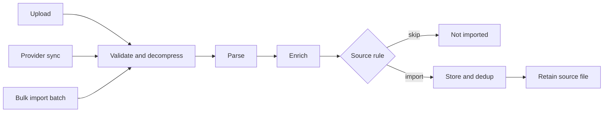
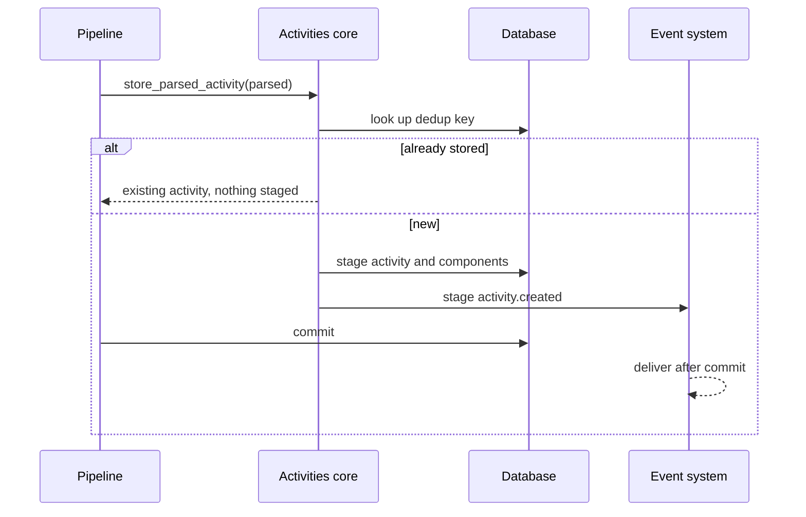

# Activity ingestion

This page describes how a file or a provider sync becomes stored activities. The code lives in `backend/app/modules/activities/`:

- `activity_ingestion/` orchestrates the entry points and the shared pipeline.
- `activity_file_import/` holds the format parsers (`.gpx`, `.tcx`, `.fit`, `.gz`).
- `activity/` is the activities core. It never imports a parser or a provider.

Two import-linter contracts enforce that split: `activities-parsing-boundary` and `ingestion-pipeline-provider-agnostic`.

## One pipeline, three entry points

Upload, provider sync (Garmin Connect, Strava) and bulk import differ only in how the file arrives and what happens on failure. They all call the same pipeline.

On failure the entry points differ: an upload cleans up and re-raises, a provider sync logs and returns nothing, and a bulk import counts the file as failed and keeps its bytes.

## What happens to a parsed activity

Parsers are pure functions. They return a canonical `ParsedFile` and know nothing about the database, privacy settings, gear or providers. The pipeline then applies these steps to each activity in the file:

1. **Enrich:** re-attach the owner's privacy defaults, gear and provider ids (`enrichment_service`).
2. **Source rules (bulk imports only):** the source's `should_import` hook decides whether to keep an activity, for example to skip duplicate listings in a Strava export. Then `apply_metadata` applies the manifest's name, description, type and gear.
3. **Deduplicate:** `store_parsed_activity` derives a key, in this order of precedence, and skips the activity if the owner already has it.

    | Source | Key |
    | --- | --- |
    | Strava activity id | `strava:<id>` |
    | Garmin activity id | `garmin:<id>:<start time>` (a multi-activity `.fit` shares one Garmin id) |
    | File content | `file:<sha256>:<start time>` |
    | None of these | Falls back to start-time matching: the activity is stored but hidden, with a notification |

    A unique index on `(user_id, dedup_key)` settles concurrent imports of the same activity. The loser rolls back and returns the winner.
4. **Persist components:** the activity row and its children (laps, sets, streams, workout steps and so on) are staged through contributors registered in `contributor_registry`. A parsed component with no registered contributor fails the import instead of being dropped silently.
5. **Publish `activity.created`:** staged in the same transaction as the rows. The pipeline commits once per activity, so a later failure does not undo earlier activities.

## Derived work

Nothing in the ingestion path knows what consumes `activity.created`. Independent subscribers react to it:

- map thumbnail generation (`activity_thumbnail`)
- reverse geocoding (`activity_geocoding`)
- notifications (`notifications`)

Every subscriber also has a scheduled backfill that repairs missed events. How delivery works, locally and distributed, is covered in [Scaling and background jobs](../getting-started/scaling-and-background-jobs.md#how-events-are-delivered).

## Adding to the pipeline

- **A new file format:** register a parser for its extension in `activity_file_import/parser_registry.py`. Return the canonical `ParsedFile`, with no database or provider coupling.
- **A new component stored with each activity:** register an activity-ingestion contributor in `contributor_registry`. File-scoped reference data uses a file-ingestion contributor.
- **A new provider export with its own rules:** subclass `BulkImportSource` and override `metadata_for`, `should_import` and `apply_metadata`, as the Strava export does. Do not branch on the provider inside the pipeline.
