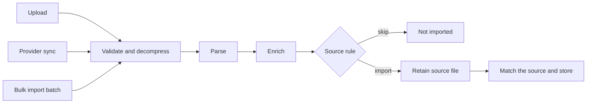
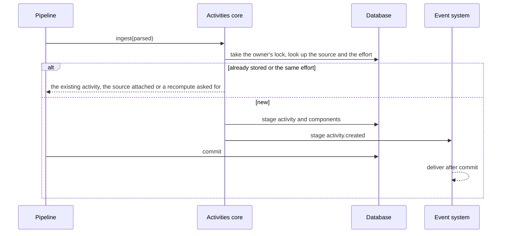

# Activity ingestion

This page describes how a file or a provider sync becomes stored activities. The code lives in `backend/app/modules/activities/`:

- `activity_ingestion/` orchestrates the entry points and the shared pipeline.
- `activity_file_import/` turns a file into activities (`.gpx`, `.tcx`, `.fit`): a decoder per format reads the file into a `Recording` (sessions with sample columns, laps and the device summary, no math), and one shared `assembly` builds an activity from each session, using the device's own totals and computing what the file leaves out. The pipeline decompresses a `.gz` before parsing.
- `activity/` is the activities core. It never imports a parser or a provider.

Activities imported before file rows existed have no `file_id`; their file is still read and deleted by activity id (`processed/{activity id}`) until the reprocess walk (migration row 15) adopts it into a row. The walk adopts a file under the key it has, after trying to regroup the legs of its file and before it writes the recomputed values, in one transaction under the owner's matching lock: the row (the user's live row of the same bytes when there is one, in which case the activity's own blob is deleted after the commit), the activity's `file_id`, and the precedence of its file source from the file's format. An activity the walk did not rewrite has its old `activities_streams` converted to `activity_samples`, and its start point set from them, in a transaction of its own. A leg never takes a file; its parent keeps it.

Three import-linter contracts enforce that split: `activities-provider-agnostic` (the activities module imports no provider), `activities-parsing-boundary` (the core imports no parser) and `ingestion-pipeline-format-agnostic` (the pipeline imports no parser directly).

## One pipeline, three entry points

Upload, the Garmin Connect sync and bulk import differ only in how the file arrives and what happens on failure. They all call the same file pipeline. The Strava sync has no file: it builds the parsed activity from the API response and enters at the store step (`store_parsed_activity`).

On failure the entry points differ: an upload cleans up and re-raises, a Garmin Connect sync logs a file the pipeline refuses and moves on (a database or storage outage is raised, so the refresh job retries the window), and a bulk import counts the file as failed and keeps its bytes (an outage is raised, so the batch resumes from its cursor).

On the local profile with one web worker the in-process pool is the only place a job runs, so startup submits every open upload and bulk import again (`resume_orphaned_local_jobs`). Re-running is safe because uploads and bulk-import members are deduplicated by content and a bulk import resumes after its cursor. A job with no staged blob, such as a folder import that was still being packed, is failed.

## What happens to a parsed activity

Decoding and assembly are pure functions. They return a canonical `ParsedFile` and know nothing about the database, privacy settings, gear or providers. The pipeline then applies these steps to each activity in the file:

1. **Enrich:** re-attach the owner's privacy defaults, gear and provider ids (`enrichment_service`).
2. **Source rules (bulk imports only):** the source's `should_import` hook decides whether to keep an activity, for example to skip duplicate listings in a Strava export. Then `apply_metadata` applies the manifest's name, description and gear.
3. **Match the source and the effort:** `ingest` (and `ingest_group` for a multisport file) identifies the recording by one source, in this order of precedence, then looks for an activity of the owner's that it is a recording of.

    | Source of the activity | Stored as | Identity |
    | --- | --- | --- |
    | Strava activity id | `strava` source | The id |
    | Garmin activity id | `garmin` source | The id and the recording's start (a multi-activity `.fit` shares one Garmin id); the id alone for a multisport parent |
    | File content | `file` source | The file's SHA-256 and the recording's start; the hash alone for a multisport parent |
    | None of these | No source | The activity is stored without one |

    The activity's `activity_sources` rows hold these identities, in the `activity` module next to the activity row. A start is kept in whole seconds, and a Strava activity has none. A file source copies the file's hash and does not reference `activity_files`: the retained file is deleted with its last activity, and the source must outlive it. Two unique indexes, one on `(user_id, kind, provider_id, session_start)` and one on `(user_id, file_sha256, session_start)`, settle concurrent imports of the same activity. The loser rolls back and returns the winner. `precedence` records how far the source's data is trusted (a device file 2, a TCX or GPX file 1, the Strava API 0).

    A Garmin source carries the id only and a file source the hash only, so every row has exactly one identity. The activity's `strava_activity_id` and `garminconnect_activity_id` are read from its sources; the columns of the same names are written and never read, and `dedup_key` is no longer written or read. A leg of a multisport activity keeps the source of its own session, as its key was before sources existed.

    An activity that has a Strava source and no other is live Strava data, which only its owner may see. An activity a file also recorded is not.

    **Matching** runs in the store transaction, after the file is staged (staging commits), and its first statement takes the owner's lock, `pg_advisory_xact_lock(hashtextextended('activity_match:' || user_id, 0))`, held to the commit so two imports of one user take turns, across replicas. Then, in order:

    1. **Exact:** the owner holds the recording's source (the same file or provider activity): `EXISTING`, nothing is stored.
    2. **Same effort:** the owner has a top-level activity (a leg is stood for by its parent) that starts within seven days before the recording's end and overlaps it by at least 80% of the shorter of the two (`activities.computation.is_same_effort`; a recording of no length matches only one that starts in its second), in a compatible sport: the same type, two types of one sport in `ACTIVITY_TYPES_BY_SPORT`, or a multisport activity with any type. A type in no sport matches only itself. The greatest overlap wins. The look reads `ix_activities_user_id_start_time`. A multisport file is matched by its parent only.
    3. **Otherwise** the activity is created: `CREATED`.

    **Precedence** is stored on each source: a device file (a `.fit`, the Garmin sync) 2, a `.tcx` or `.gpx` 1, the Strava API 0. An activity none of whose sources is known (a manual entry, a restored one without sources) counts as 2, so it is never replaced. A matched recording whose precedence is not above the activity's best, or whose structure differs (a multisport recording against a single activity, or the reverse), is **attached**: the source is added to the activity's loaded `sources` through the ORM, `updated_at` moves, `version` does not, nothing is published and no audit row is written. A tie keeps the stored recording. A strictly better one gives `BETTER_SOURCE`, and the pipeline **recomputes** the activity in place (`recompute_service.stage_recompute`, on the same session, under the same lock):

    - the activity is locked and must still reference the file row the match saw and hold no source as good as the incoming one; otherwise the source is attached instead;
    - it references the new file row, which is marked attached, and every derived column and `start_time` take the new values, empty ones included (`DERIVED_FIELDS`);
    - its components are cleared and stored again, and the thumbnail is cleared when the route changed, as in a reprocess;
    - what the owner, a provider or geocoding owns stays, and so does `version`, **except** when the activity's only sources are Strava's: it then also takes the file's `name` and `description` and its `version` is bumped, because both are client-editable and a stale write must get `412`;
    - the new source is added, and after the commit the replaced file is released (`release_unreferenced`, or the legacy file removed by activity id).

    A Strava listing is matched before anything is fetched (`attach_strava_activity_if_known`): its start, length and sport are enough to attach it to an effort the user has, and no detail, streams or laps call is made. The reprocess data migration writes an activity's values only while it still references the file it read, so a recompute that commits meanwhile is not overwritten.

    A profile restore skips an archived activity the account already has, by a source or the same effort (no recompute, no attach), with its legs and components, and counts it as `activities_skipped`; activities the restore stored itself do not count.
4. **Persist components:** the activity row and its children (laps, sets, streams, workout steps and so on) are staged through contributors registered in `contributor_registry`. A parsed component with no registered contributor fails the import instead of being dropped silently.
5. **Retain the source file:** before the first activity of a file is stored, the pipeline stages the original file as an `activity_files` row (`pending`) in its own short transaction and writes the blob with no session open. The activity is stored with that row's id (`activities.file_id`; the activities core treats it as an opaque id and never imports `activity_file_storage`), and the same transaction marks the row `attached`. A user has one live row per SHA-256, so uploading bytes the user already has, or a multi-activity `.fit`, shares the row instead of writing another copy. A file that stores no activity (a duplicate, a skipped bulk-import member, an empty file) releases the row this import created. A crash between the blob and the activity leaves a `pending` row, which the next import of the same bytes takes over and the daily sweep removes after a day.
6. **Publish `activity.created`:** staged in the same transaction as the rows. The pipeline commits once per activity, so a later failure does not undo earlier activities.

A FIT file whose `activity` message marks it multisport (`auto_multi_sport`) is the exception: the parser returns a multisport parent with the sessions as its legs, and `ingest_group` stages the parent and every leg in one transaction, committed once. The legs copy the parent's privacy, only the parent is matched to an effort, the parent holds the whole file's source and each leg its session's, only the parent references the retained file (the legs have no `file_id`), and the pipeline returns the parent alone. A Garmin multisport activity is listed once, so the sync reads its legs' Garmin ids and each leg's gear, resolves it to local gear and passes it as `GarminSource.leg_gear`; leg *i* takes entry *i* when the counts match, otherwise no leg takes Garmin gear (logged) and each falls back to its default. The parent never takes gear. A file whose legs were stored on their own before groups existed is left as it is.

## Derived work

Nothing in the ingestion path knows what consumes `activity.created`. Independent subscribers react to it:

- map thumbnail generation (`activity_thumbnail`)
- reverse geocoding (`activity_geocoding`)
- notifications (`notifications`)

Thumbnails and geocoding also have a scheduled backfill that repairs missed events; notifications are transient and have none. How delivery works, locally and distributed, is covered in [Scaling and background jobs](../getting-started/scaling-and-background-jobs.md#how-events-are-delivered).

## Adding to the pipeline

- **A new file format:** write a decoder that returns a `Recording` and register it for its extension in `activity_file_import/parser_registry.py`; `assembly` and the adapter produce the canonical `ParsedFile`, with no database or provider coupling.
- **A new component stored with each activity:** register an activity-ingestion contributor in `contributor_registry`. File-scoped reference data uses a file-ingestion contributor.
- **A new provider export with its own rules:** subclass `BulkImportSource` and override `metadata_for`, `should_import`, `apply_metadata` or `import_side_artifacts` as needed; the Strava export overrides `metadata_for`, `should_import` and `import_side_artifacts`. Do not branch on the provider inside the pipeline.
