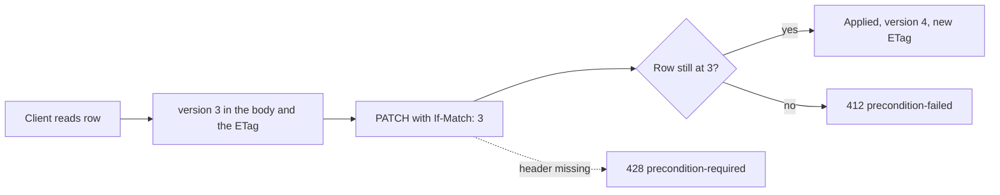

# Versioned writes: ETag and If-Match

This page explains how Endurain stops two clients from silently overwriting each other, and what a new resource must do to take part. The client-facing contract (what to send, which status you get) is in [Errors, concurrency and rate limits](../integrate/errors-and-limits.md#concurrent-edits-with-etag-and-if-match); read it first if you build on the API.

## The idea

A row that two clients can edit carries a `version` counter. Reading the row tells the client the version. Writing it, the client says "I am editing version 3" in an `If-Match` header. If the row is still at version 3 the write applies and the version becomes 4. If it is not, the write is refused and nothing changes.



Without this a `PATCH` is last-writer-wins: the app open on a phone and a laptop is enough to lose an edit with no error and no trace.

The version travels as an HTTP entity tag, the standard mechanism for this, so no bespoke field is needed in every payload. The tag is the version in quotes (`"3"`), a *strong* tag.

The Strava client credentials are versioned with the rest of the user's integrations: `GET /profile` carries
`integrations_version`, and `PUT /strava/client` requires it in `If-Match`. Ending a fast with
`POST /health/fasting/{id}/complete` changes the session, so it requires the session's version too.

The identity-provider administration form edits a stored provider with `PUT /identity-providers/{idp_id}`. Its list items carry the
version, the create and update responses return an `ETag`, and the update requires that tag in `If-Match`.

## Where each piece lives

| Layer | File | What it does |
| ----- | ---- | ------------ |
| Column | `models.py` | `version` plus `version_id_col`, so SQLAlchemy bumps it on every flush and guards the `UPDATE`. |
| Read schema | `schema.py` | `version` on `<Thing>Read`, so every list item and record carries it. |
| Precondition | `crud.py` | Compares `If-Match` with the version of the row it is about to change. |
| Race guard | `service.py` | Turns a write that lost the race at flush time into the same refusal. |
| Route | `router.py` | Requires the header and returns the new `ETag`. |
| Helpers | `core/etag.py`, `core/dependencies.py` | Format and parse tags, enforce the check, require the header. |

### 1. The column

```python
version: Mapped[int] = mapped_column(
    nullable=False,
    server_default="1",
    default=1,
    comment="Optimistic-concurrency counter, surfaced to clients as the ETag",
)

# SQLAlchemy bumps ``version`` on each ORM flush and adds it to the UPDATE's
# WHERE clause, raising StaleDataError when the row moved underneath.
__mapper_args__ = {"version_id_col": version}
```

The migration adds the column as `NOT NULL` with `server_default` 1, so existing rows start at version 1 (see `14_health_version` and `15_users_version`).

### 2. The read schema

```python
version: StrictInt = Field(default=1, ge=1, description="Optimistic-concurrency counter, also sent as the ETag")
```

It belongs on the `Read` model only. A create or update body never carries a version: the client names it in the header, not the payload.

### 3. The check in `crud`

```python
db_row = _get_row(row_id, user_id, db)
core_etag.require_if_match(if_match, db_row.version, "gear")
```

It runs against the very row that is then edited, before any attribute is set. Checking a copy read earlier would leave a window in which the row changes between the check and the load. `require_if_match` accepts a list of tags, ignores weak tags (`If-Match` needs strong comparison) and treats `*` as "any version".

### 4. The race guard in `service`

The check above compares what the client sent with what the row held when it was loaded. A second writer can still commit between that load and the `UPDATE`. SQLAlchemy catches that: the `UPDATE ... WHERE version = <loaded>` matches no row and raises `StaleDataError`. `refuse_stale_write` turns it into the same `412`, or a `404` when the row was deleted meanwhile:

```python
with core_etag.refuse_stale_write(
    db,
    "gear",
    lambda: gears_crud.gear_exists(gear_id, user_id, db),
    "Gear not found",
):
    updated = gears_crud.edit_gear(gear_id, gear, user_id, db, if_match=if_match)
    db.commit()
```

The commit goes inside the block, because a version conflict can surface at `commit` as well as at `flush`. The `still_exists` callable runs after the rollback.

### 5. The route

```python
def edit_gear(
    ...,
    response: Response,
    if_match: core_dependencies.IfMatch,
) -> gears_schema.GearRead:
    updated = gears_service.edit_gear(gear_id, gear, token_user_id, db, if_match=if_match)
    response.headers["ETag"] = core_etag.format_etag(updated.version)
    return updated
```

`core_dependencies.IfMatch` answers `428` before the handler runs when the header is absent. Reads of a single record set the `ETag` the same way, so a client can read it from the header instead of the body.

Choose the verb by what the body is: a partial update is a `PATCH` (an omitted field is left alone), a full replacement is a `PUT` (`/server-settings`, a user, a goal). A singleton the caller owns (`/profile`, `/health/targets`) names no id.

## What bumps the version

Any ORM flush that changes the row, whoever makes it: another client, an administrator, a Garmin Connect sync, the profile importer. A form opened before that change gets a `412`, which is the point. Two cases need care:

- **A bulk `UPDATE` skips the ORM's bump.** A statement such as `UPDATE ... SET amount_ml = amount_ml + :n` changes the row without raising or incrementing anything, so it must set `version = version + 1` itself (water intake and the weight BMI recalculation do).
- **Derived values do not.** Things the system computes after the fact, such as an activity's thumbnail key, are written without touching the version, so a background job never invalidates the edit form someone has open.

## Writers that are not a client

A system writer has no version to name. It passes `if_match="*"` to the service, "overwrite whatever is there", and still gets the flush-time guard. The wildcard is for in-process callers only: the `IfMatch` route dependency refuses it with 400, so an HTTP client cannot skip the stale-write check:

| Writer | Why it uses `*` |
| ------ | --------------- |
| Data migrations (`migration_service`) | They rewrite rows to a known shape. |
| The profile importer | The archive carries the exporting account's rows, so it drops `id`, `user_id` and `version` and overwrites. |
| The IDP profile sync | The identity provider is the source of truth for name and email. |
| Provider upserts (Garmin Connect health data) | The day's record is created or updated by whoever gets there first. |

An upsert that loses the version race re-reads the row and applies again, up to `UPSERT_ATTEMPTS` times (`modules/health/constants.py`). Each round lets at least one writer through, so the limit is the number of concurrent writers of one day it serves.

`users_crud.update_user` takes `if_match` as an optional argument, unlike the other CRUD functions: fourteen callers are system writers, and only the routes that serve a client require the header.

## What is not versioned

Creating and action endpoints (approve a user, change a password, link an account) take no `If-Match`: there is no earlier version for a create to be stale against, and an action does not replace a representation the client read. Deleting a versioned row does take it, because the client decides to delete what it saw: `DELETE` on activities, gears, gear components, goals, identity providers, administrator user deletion (still `202`) and the six health record types. Deleting something that has no version (API keys, sessions, activity media, the login photo) takes none. The delete checks the version in `crud` against the row it removes and the service wraps it in `refuse_stale_write`, like an edit; deleting a row that does not exist stays `404`. The bulk activity edit (`PATCH /activities`) has no single record to name; it answers 202 and runs as a job.

## Adding a versioned resource

1. Add the `version` column and `version_id_col` to the model, and a migration with `server_default` 1.
2. Add `version` to the `Read` schema. Keep it out of every create and update body.
3. In `crud`, take `if_match: str` and call `core_etag.require_if_match` on the row you edit or delete. Add a cheap `..._exists` function for the guard.
4. In `service`, wrap the edit or delete and its commit in `refuse_stale_write`. Give any other caller of the edit `if_match="*"` and a comment saying why.
5. In `router`, take `core_dependencies.IfMatch` and a `Response`, and set the `ETag` from the result. Set it on the single-record reads too.
6. Find every bulk `UPDATE` of the table and make it bump the version.
7. Frontend: map `version` through `rowVersion(dto.version)` into the model, pass it through the mutation, and send `ifMatchHeaders(version)` (`src/services/ifMatch.ts`). Regenerate the API types.
8. Tests, below.

## Tests to write

| Test | Where | What it proves |
| ---- | ----- | -------------- |
| A write without the header is `428` | the router test | The route requires `IfMatch` and the service is not called. |
| A stale tag is `412` | the router or service test | `require_if_match` is wired in. |
| A single-record read carries the `ETag` | the router test | The tag equals the record's version. |
| A write with the current version succeeds, the same write again is refused | `tests/postgres/` | The real `UPDATE ... WHERE version` guard, which a mocked session cannot exercise. |
| A bulk update changes the version | `tests/postgres/` | The statement bumps it itself. |

`tests/postgres/test_health_versions.py`, `test_users_versions.py` and `test_activity_concurrency.py` are the models to copy.

## Related

- `If-None-Match` is a different use of entity tags: the public login photo answers `304` when the client already holds the current photo. It is conditional *reads*, not conditional writes, and lives in `core.etag.matches_if_none_match`.
- [Module structure](module-structure.md#conventions-that-look-like-drift) lists the versioned-writes convention among the settled ones.
