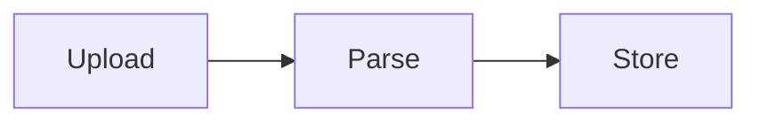

# Writing the documentation

The documentation is a [MkDocs](https://www.mkdocs.org/) site with the Material theme, built from `docs/` and configured in `mkdocs.yml`.

## Preview and build

Run MkDocs through the backend project so the right plugins are installed:

```bash
DISABLE_MKDOCS_2_WARNING=true uv run --project backend --group docs mkdocs serve
```

Use `mkdocs build --strict` instead of `serve` to find broken links. The `DISABLE_MKDOCS_2_WARNING` variable only silences a banner printed by one of the plugins. The site is built and published by the `docs` GitHub workflow.

## Layout

| Folder | Audience | Content |
| ------ | -------- | ------- |
| `getting-started/` | People hosting Endurain | Install, reverse proxy, updates, scaling, troubleshooting |
| `features/` | Users and administrators | What Endurain does and how to use it |
| `integrate/` | People building on the API | Authentication, errors, supported types |
| `developer-guide/` | Contributors | Module structure, ingestion, events, UX guidelines |
| `reference/` | Contributors | Generated Python API reference |

Every page must be listed under `nav:` in `mkdocs.yml`. Name files with hyphens (`export-import.md`).

## Moving or renaming a page

Published URLs are linked from outside the docs: `README.md`, `.env.example`, `docker/start.sh`, blog posts and other sites. When you move or rename a page:

1. Add the old path to `redirect_maps` under the `redirects` plugin in `mkdocs.yml`.
2. Search the repository for the old path and update the links, including `AGENTS.md`, which links to some developer-guide files.

## Diagrams

Mermaid diagrams are supported. Use a fenced block with the `mermaid` language:

````markdown

````

The Mermaid library is loaded in the browser, so readers need internet access to see the rendered diagram. Keep diagrams small and say the same thing in the surrounding text.

## Tables generated from the code

Some tables are filled in from the backend source when the docs are built, so they cannot drift. Put a marker on its own line where the table belongs:

| Marker | Fills in |
| ------ | -------- |
| `<!-- generated:scopes -->` | Every scope in `SCOPE_DICT` |
| `<!-- generated:api-key-scopes -->` | The scopes an API key may hold |
| `<!-- generated:api-key-endpoints -->` | The API key management routes |
| `<!-- generated:error-types -->` | The error types and their HTTP statuses |
| `<!-- generated:rate-limits -->` | The rate-limit tiers |

The code is in `mkdocs_hooks/auth_docs.py`. It reads the backend with Python's `ast` module and does not import it, so the docs build needs no backend dependencies. If a source it reads is moved or renamed, the build fails and you update the hook. To add a table, write a function that returns a Markdown table and add it to `GENERATORS`.

## Python API reference

Pages under `reference/` use [mkdocstrings](https://mkdocstrings.github.io/). A section is a heading followed by a directive naming the module:

````markdown
## Service

::: backend.app.modules.followers.service
    handler: python
    options:
      docstring_style: google
````

The text comes from the docstrings, which use the Google style (`Args`, `Returns`, `Raises`). Fix a wrong reference page by fixing the docstring. Add a new module to the page of its area, or add a page and list it in `nav:`.

## Reusing fragments

Shared HTML such as the newsletter form and the secret generators lives in `docs/_snippets/` and is included with `--8<-- "_snippets/name.html"`.
