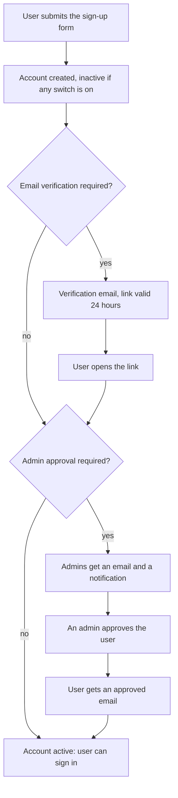
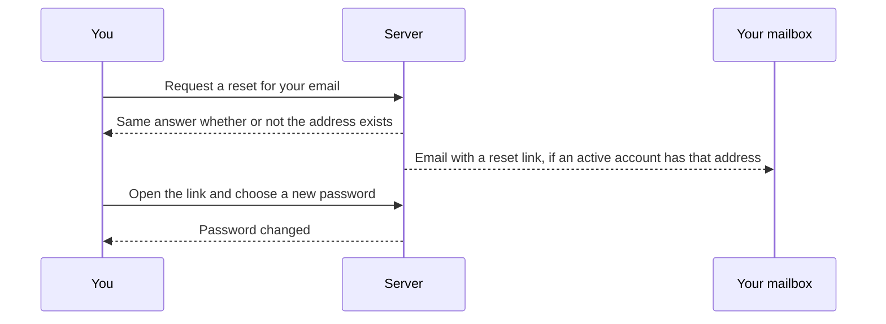

# Accounts, sign-up and password reset

This page describes how an account is created, how a forgotten password is recovered, and how you secure your account. Administrators set the rules in [Server settings](server-settings.md); [user management](user-management.md) covers what they can do to accounts.

## Signing up

Sign-up is available only when an administrator has enabled it. The rules for new accounts are two independent switches:

| Switch | Effect |
| ------ | ------ |
| Require email verification | The new user must click a link sent to their address before they can sign in |
| Require admin approval | An administrator must approve the new user before they can sign in |

With neither switch on, the new account is active at once. With either on, it starts inactive.

Details that matter:

- The form's response never reveals whether an email address is already registered. A sign-up with a registered address looks exactly like a successful one, and the address's owner gets an email saying that someone tried to sign up (when mail is configured, at most once an hour per account) and that nothing changed. A taken username is reported, because usernames are visible to every signed-in user.
- Emails need a working mail server. Without one, verification and approval emails cannot be sent; configure it in [Server settings](server-settings.md#email).
- An administrator can only approve a user whose email is verified. If only admin approval is required, no verification email is sent, so the account stays unverified until an administrator marks the email verified in [user management](user-management.md#approving-sign-ups). Turn email verification on together with approval to avoid this.
- The verification link is valid for 24 hours.
- A new account starts with default settings: privacy settings, health targets, empty default gear and integration slots.

## Signing in

You sign in with your username (or email) and password. Sign-in uses the address the account currently has, even while a change to a new address is waiting for confirmation. If your account has two-step verification, Endurain asks for a code as a second step. If an administrator has enabled single sign-on, the login page also shows a button per identity provider; see [Single Sign-On](single-sign-on.md).

After repeated wrong passwords the account is locked for a while, with longer locks for more failures. The limits are in [Account security](../integrate/account-security.md#progressive-account-lockout).

## Forgotten password

On the login page choose the forgotten password link and enter your email.

- The reset link is valid for one hour and works once. It is sent to the address the account currently has, not to a new address still waiting for confirmation.
- The answer on the page is always the same. This stops anyone from using the form to find out which emails have accounts.
- Inactive accounts (not yet verified or approved, or deactivated) get no email.
- Accounts without a local password (they sign in through an identity provider) get no email, and an already-issued reset link no longer works for them. An administrator can [set a password](user-management.md#resetting-a-password).
- When an administrator turned off [local username and password login](single-sign-on.md#auto-redirect-to-sso), resets and password sign-in are refused for regular users, answered like a wrong password. Administrators keep both.
- An account is emailed at most once every five minutes, so the form cannot be used to flood an inbox. A second request inside that time gets the same answer and no new email; use the link from the first one, or ask again afterwards.
- If the server has no mail configured, the request is answered with a "service unavailable" error. Ask an administrator to reset the password in [user management](user-management.md#resetting-a-password).
- The new password must satisfy the server's password policy.

## Password rules

Passwords follow [NIST SP 800-63B-4](https://pages.nist.gov/800-63-4/sp800-63b.html): length matters, character mixes do not. A new password must:

- be at least as long as the minimum an administrator set for the account type, 15 characters by default (8 to 128). Every character counts, including spaces and non-Latin letters;
- not be a commonly used or breached password. Endurain checks it against a list of about 75,000 such passwords shipped with the server, ignoring case;
- not be the account's username, email address, the part of the email before the `@`, or "endurain".

No upper-case letters, digits or symbols are required. The form shows a strength meter as a guide; only the rules above can refuse a password, and the message says which one. Passwords are compared in Unicode NFC form, so the same text typed on different devices is the same password. Existing passwords keep working when the rules change; the rules apply the next time a password is set.

## Securing your account

Under **Settings → Security** you can:

- change your password and email. Both ask you to confirm with your current password, and with a code if two-step verification is on. A new email takes effect when you follow the link sent to it, valid for 24 hours. Until then your current address stays in place, and Settings shows the pending address with buttons to resend the link or cancel the change. Once the change is confirmed, the previous address gets a notice. If the server has no mail configured, a new email takes effect at once, unverified;
- turn two-step verification (a TOTP authenticator app) on or off, and regenerate its ten one-time backup codes. Each code has the form `XXXX-XXXX` and works once, and generating new ones invalidates the old;
- see your signed-in sessions and sign out of any of them or all the others;
- link or unlink identity providers;
- create and revoke [API keys](../integrate/api-keys.md), which can upload activities;
- delete your account.

Accounts that sign in only through single sign-on have no local password. They cannot change a password themselves, and they confirm sensitive changes by signing in again with their identity provider; see [Single Sign-On](single-sign-on.md#confirming-sensitive-changes-without-a-password).

Deleting an account signs you out at once and deletes its data in the background, including activities, photos, thumbnails and stored files. The only administrator of a server cannot delete or demote themselves; make another user an administrator first.

### Security notifications

Endurain tells you when the way you sign in changes: your password is changed, reset, or set by an administrator; two-step verification is turned on or off; new backup codes are generated; an API key is created; or an identity provider is linked or unlinked. You get an email at your current address, if the server has mail configured, and a notification in the app. If you did not make the change, reset your password and review **Settings → Security**, or contact your administrator for a change made by one.

The email is the notice that counts: someone who has taken over a session can read and dismiss in-app notifications, but not your mailbox. Signing in does not send one.
