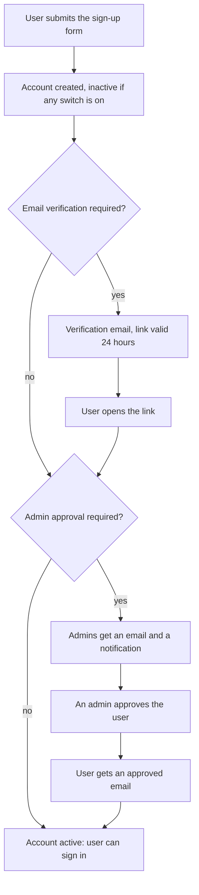
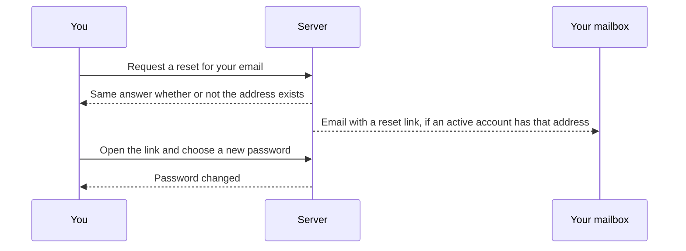

# Accounts, sign-up and password reset

This page describes how an account is created, how a forgotten password is recovered, and how you secure your account. Administrators set the rules in [Server settings](server-settings.md); [user management](user-management.md) covers what they can do to accounts.

## Signing up

Sign-up is available only when an administrator has enabled it. The rules for new accounts are two independent switches:

| Switch | Effect |
| ------ | ------ |
| Require email verification | The new user must click a link sent to their address before they can sign in |
| Require admin approval | An administrator must approve the new user before they can sign in |

With neither switch on, the new account is active at once. With either on, it starts inactive.

Details that matter:

- The form's response never reveals whether a username or email was already taken. It says only that the account could not be created.
- Emails need a working mail server. Without one, verification and approval emails cannot be sent; configure it in [Server settings](server-settings.md#email).
- An administrator can only approve a user whose email is verified. If only admin approval is required, no verification email is sent, so the account stays unverified until an administrator marks the email verified in [user management](user-management.md#approving-sign-ups). Turn email verification on together with approval to avoid this.
- The verification link is valid for 24 hours.
- A new account starts with default settings: privacy settings, health targets, empty default gear and integration slots.

## Signing in

You sign in with your username (or email) and password. If your account has two-step verification, Endurain asks for a code as a second step. If an administrator has enabled single sign-on, the login page also shows a button per identity provider; see [Single Sign-On](single-sign-on.md).

After repeated wrong passwords the account is locked for a while, with longer locks for more failures. The limits are in [Account security](../integrate/account-security.md#progressive-account-lockout).

## Forgotten password

On the login page choose the forgotten password link and enter your email.

- The reset link is valid for one hour and works once.
- The answer on the page is always the same. This stops anyone from using the form to find out which emails have accounts.
- Inactive accounts (not yet verified or approved, or deactivated) get no email.
- If the server has no mail configured, the request is answered with a "service unavailable" error. Ask an administrator to reset the password in [user management](user-management.md#resetting-a-password).
- The new password must satisfy the server's password policy.

## Password rules

An administrator chooses one of two policies and a minimum length for regular users and for administrators (8 to 128 characters):

| Policy | Requires |
| ------ | -------- |
| Strict | An uppercase letter, a lowercase letter, a digit and a special character, besides the minimum length |
| Length only | Only the minimum length |

## Securing your account

Under **Settings → Security** you can:

- change your password and email. Both ask you to confirm with your current password, and with a code if two-step verification is on. A changed email must be verified again;
- turn two-step verification (a TOTP authenticator app) on or off, and regenerate its ten one-time backup codes. Each code has the form `XXXX-XXXX` and works once, and generating new ones invalidates the old;
- see your signed-in sessions and sign out of any of them or all the others;
- link or unlink identity providers;
- create and revoke [API keys](../integrate/api-keys.md), which can upload activities;
- delete your account.

Accounts that sign in only through single sign-on have no local password, so password prompts are skipped for them. They still need a code if two-step verification is on.

Deleting an account deletes its data, including activities, photos, thumbnails and stored files. The only administrator of a server cannot delete or demote themselves; make another user an administrator first.
