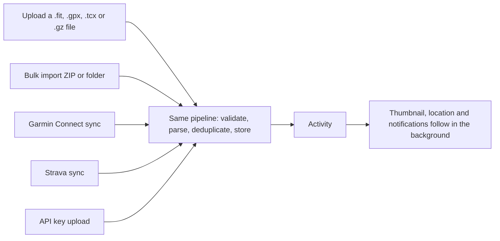

# Activities

An activity is one recorded workout. This page covers what Endurain shows for one, how you find activities, and what you can change. For getting activities in, see [Importing data](importing.md) and [Integrations](integrations.md). For who can see them, see [Sharing, privacy and followers](sharing-and-privacy.md).

## Where activities come from

Whatever the source, an activity goes through the same steps, so duplicates are caught the same way. The thumbnail, the reverse-geocoded location and notifications arrive a little later, because they are produced in the background (see [Background work and failure handling](../getting-started/background-work-by-module.md)).

## The activity page

| Section | What it shows |
| ------- | ------------- |
| Header | Name, type, start time, location, owner and, for you, the actions menu |
| Map | The route, when the activity has GPS and its map is not hidden |
| Metrics | Distance, time, pace or speed, elevation gain and loss, calories, heart rate, power and cadence when recorded |
| Charts | One chart per recorded stream: heart rate, power, cadence, elevation, speed and pace |
| Heart-rate zones | Time spent in each zone |
| Laps | A table of laps |
| Workout sets and steps | Sets, and the steps of a structured workout |
| Gear | The gear used, linking to its page |
| Photos | The activity's gallery |

### How the numbers are computed

What the device recorded wins: distance, timer time, ascent and descent, average and maximum speed, heart rate, power, cadence and laps come from the file when it holds them. Endurain computes a value only when the file lacks it, with the same rules for .fit, .gpx and .tcx files. Strava sync keeps Strava's own totals and computes what Strava does not send (the elevation chart and loss, normalized power, average cadence and lap power) with the same rules.

- **Cleaning.** Before anything is computed from a file, a position at 0,0 is dropped, and so is a position or speed faster than the sport allows: 12 m/s on foot, 35 m/s on a bike, 6 m/s on water and 50 m/s otherwise. A heart rate of 0 is a dropout and counts as missing.
- **Averages** of heart rate, power, cadence and speed weigh each sample by the time until the next one, so a watch that records more often while you move does not skew them. A cadence of 0 is left out of the average; a power of 0 counts.
- **Pauses.** A gap between samples longer than both 15 seconds and three times the usual gap of the recording is a pause: it adds no moving time, and in an average or a heart-rate zone it counts as no more than that threshold.
- **Moving time and distance.** You are moving while your speed is at least 0.5 m/s (0.3 m/s on water). For a GPS track, the straight-line distance covered over 10 seconds must also give that speed, so GPS jitter while you stand still counts neither as moving time nor as distance.
- **Maximum speed** is the fastest 5 seconds, not the fastest single sample.
- **Normalized power** is the standard 30-second rolling average of power; an activity or lap with less than 30 seconds of power has none.
- **Elevation.** The elevation chart shows the recorded elevation smoothed over 10 seconds (at least ten samples on a sparse recording), and Endurain's gain and loss count only climbs and descents of at least 3 m on that series, so a flat route gains nothing from barometer or GPS noise. A device's own totals are kept and can differ from the chart.
- **Laps.** The device's laps when it recorded any; otherwise one lap per kilometre (per mile when you use imperial units) of moving distance, over the whole activity, so the laps add up to the activity.

Activities imported before v0.22 are recomputed from their original file after the upgrade; see [Changes from v0.21 to v0.22](../integrate/changes-v0.21-to-v0.22.md#before-you-upgrade).

### Heart-rate zones

Zones are computed when you open the activity, not stored, so changing your maximum heart rate updates old activities too. A zone holds the time spent in it, not a count of samples. The boundaries are 60, 70, 80 and 90 % of your maximum heart rate. The maximum is the value in your profile; without one, Endurain uses 220 minus your age from your birthdate. Without either there are no zones.

## Finding activities

- **Home:** your week and month totals and goal progress, and a feed with two tabs: **My activities** and **Following** (what the people you follow share with you), newest first.
- **Search:** find activities by name, and filter by activity category.
- **Lists:** a user's page, and a gear's page, list their activities. Lists can be sorted by start time, name, type, location, distance, duration, pace, elevation, calories or average heart rate.
- **Summary:** totals for a week, month, year or your whole history, optionally for one activity type. Weeks start on your first day of the week.

## Changing an activity

Open the actions menu on your own activity.

| Field | Notes |
| ----- | ----- |
| Name | |
| Description | Visible to whoever can see the activity |
| Private notes | Visible only to you |
| Type | Changing it changes how the activity counts in [goals](goals.md) and summaries |
| Gear | The [gear](gear.md) used |
| Visibility | Public, followers or private |
| Hide this activity from everyone | Removes it from lists, feeds and goals |
| Hide from others | Hides individual details: start time, location, map, heart rate, power, cadence, elevation, speed, pace, laps, workout sets and steps, gear |

You can also **add a photo** (images only) and **delete** the activity. Deleting removes its laps, streams, photos, thumbnail and stored source file as well.

### Visibility and hiding details

New activities take your defaults from **Settings → My profile → Privacy**. To change every activity you already have at once, use **Existing activities visibility** there. The defaults and the per-activity switches are described in [Sharing, privacy and followers](sharing-and-privacy.md).

### Saving over someone else's edit

Each activity carries a version. If you save an activity that changed since you opened it (for example you edited it on two devices), the save is refused instead of overwriting the other change. Reload and apply your change again. API clients see `412`; see [Errors, concurrency and rate limits](../integrate/errors-and-limits.md#concurrent-edits-with-etag-and-if-match).
