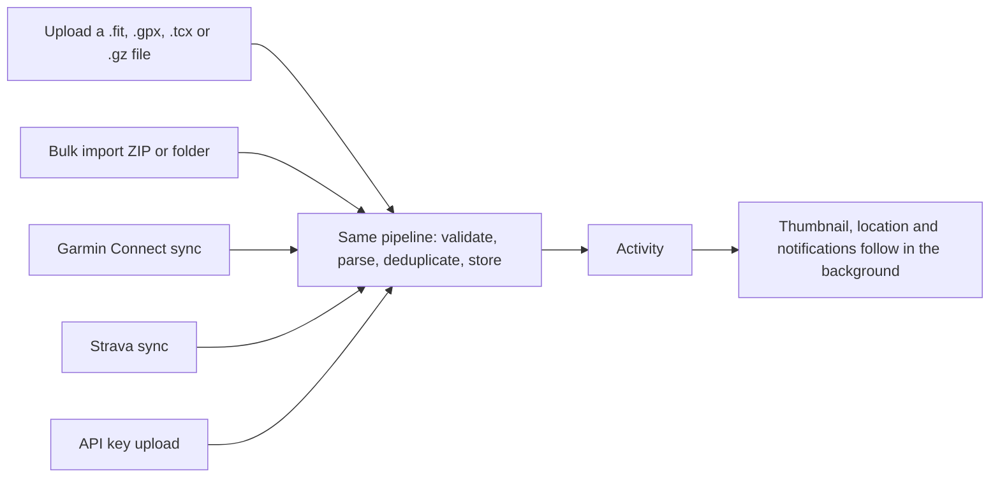

# Activities

An activity is one recorded workout. This page covers what Endurain shows for one, how you find activities, and what you can change. For getting activities in, see [Importing data](importing.md) and [Integrations](integrations.md). For who can see them, see [Sharing, privacy and followers](sharing-and-privacy.md).

## Where activities come from

Whatever the source, an activity goes through the same steps, so duplicates are caught the same way. The thumbnail, the reverse-geocoded location and notifications arrive a little later, because they are produced in the background (see [Background work and failure handling](../getting-started/background-work-by-module.md)).

## The activity page

| Section | What it shows |
| ------- | ------------- |
| Header | Name, type, start time, location, owner and, for you, the actions menu |
| Map | The route, when the activity has GPS and its map is not hidden |
| Metrics | Distance, time, pace or speed, elevation gain and loss, calories, heart rate, power and cadence when recorded |
| Charts | One chart per recorded stream: heart rate, power, cadence, elevation, speed and pace |
| Heart-rate zones | Time spent in each zone |
| Laps | A table of laps |
| Workout sets and steps | Sets, and the steps of a structured workout |
| Gear | The gear used, linking to its page |
| Photos | The activity's gallery |

Elevation is smoothed when the activity is stored, so the chart and the elevation gain agree. See [Importing data](importing.md#notes-on-the-generic-bulk-import).

### Heart-rate zones

Zones are computed when you open the activity, not stored, so changing your maximum heart rate updates old activities too. The boundaries are 60, 70, 80 and 90 % of your maximum heart rate. The maximum is the value in your profile; without one, Endurain uses 220 minus your age from your birthdate. Without either there are no zones.

## Finding activities

- **Home:** your week and month totals and goal progress, and a feed with two tabs: **My activities** and **Following** (what the people you follow share with you), newest first.
- **Search:** find activities by name, and filter by activity category.
- **Lists:** a user's page, and a gear's page, list their activities. Lists can be sorted by start time, name, type, location, distance, duration, pace, elevation, calories or average heart rate.
- **Summary:** totals for a week, month, year or your whole history, optionally for one activity type. Weeks start on your first day of the week.

## Changing an activity

Open the actions menu on your own activity.

| Field | Notes |
| ----- | ----- |
| Name | |
| Description | Visible to whoever can see the activity |
| Private notes | Visible only to you |
| Type | Changing it changes how the activity counts in [goals](goals.md) and summaries |
| Gear | The [gear](gear.md) used |
| Visibility | Public, followers or private |
| Hide this activity from everyone | Removes it from lists, feeds and goals |
| Hide from others | Hides individual details: start time, location, map, heart rate, power, cadence, elevation, speed, pace, laps, workout sets and steps, gear |

You can also **add a photo** (images only) and **delete** the activity. Deleting removes its laps, streams, photos, thumbnail and stored source file as well.

### Visibility and hiding details

New activities take your defaults from **Settings → My profile → Privacy**. To change every activity you already have at once, use **Existing activities visibility** there. The defaults and the per-activity switches are described in [Sharing, privacy and followers](sharing-and-privacy.md).

### Saving over someone else's edit

Each activity carries a version. If you save an activity that changed since you opened it (for example you edited it on two devices), the save is refused instead of overwriting the other change. Reload and apply your change again. API clients see `412`; see [Errors, concurrency and rate limits](../integrate/errors-and-limits.md#concurrent-edits-with-etag-and-if-match).
