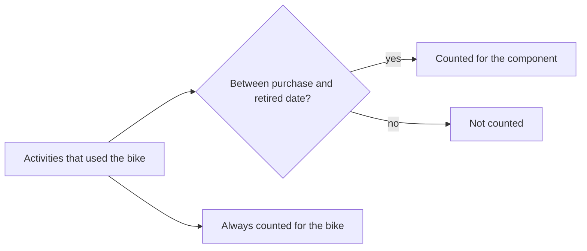

# Gear and components

Gear is the equipment you use for activities: a bike, shoes, a wetsuit and so on. Endurain adds up how much each piece has been used, and lets you track the parts fitted to it (a chain, a tire, a string) so you know when to replace them.

Manage gear on the **Gears** pages.

## Gear

| Type | Notes |
| ---- | ----- |
| Bike | Takes bike components |
| Shoes | Takes shoe components |
| Wetsuit | |
| Racquet | Has no distance, and takes racquet components |
| Skis | |
| Snowboard | |
| Windsurf | Takes windsurf components |
| Water sports board | For example a stand up paddle or surf board |

Each piece has a nickname (required, and unique among your gear), and optionally a brand, model, purchase value, creation date and an initial distance. Switch **Active** off for gear you no longer use. The purchase value is shown in the currency set in your profile.

The detail page shows:

- **Total distance:** the distance of every activity that used the gear, plus the initial distance you entered for kilometres done before you started tracking.
- **Total time:** the time of those activities.
- **Components cost:** the purchase value of its components.

To use gear on an activity, pick it in the activity's edit dialog, or set a [default gear](#default-gear) for the activity type. Deleting gear removes it from the activities that used it. The activities stay.

## Components

A component is a part of one piece of gear. Its type must fit the gear: a chain belongs on a bike, strings on a racquet. The available types are listed in [supported types](../integrate/supported-types.md#supported-bike-component-gear-types).

| Field | Meaning |
| ----- | ------- |
| Type, brand, model | What the part is |
| Purchase date | When it was fitted. Usage counts from this date |
| Retired date | When it was removed. It must be after the purchase date. A retired component is always inactive |
| Expected distance | The kilometres you expect to get from it |
| Purchase value | Its cost |

A component's **current distance and time** are the activities that used the gear between its purchase date and its retired date. A component with no purchase date shows no usage. Replace a worn part by retiring the old component and adding a new one with a new purchase date, so each part keeps its own history.

## Default gear

Under **Settings → My profile → Default gear** you can choose gear for each of these activity types: run, trail run, virtual run, ride, gravel ride, MTB ride, virtual ride, open water swim, walk, hike, tennis, alpine ski, nordic ski, snowboard and windsurf. A new activity of that type gets the gear automatically, whether you upload it or it comes from a sync.

## Gear from Strava and Garmin Connect

Use **Retrieve gear** in the integration's menu on **Settings → Integrations** to import your provider's gear in the background. Activities synced from the provider are then linked to that gear. Gear imported from Strava is removed again when you unlink Strava. See [Integrations](integrations.md).
