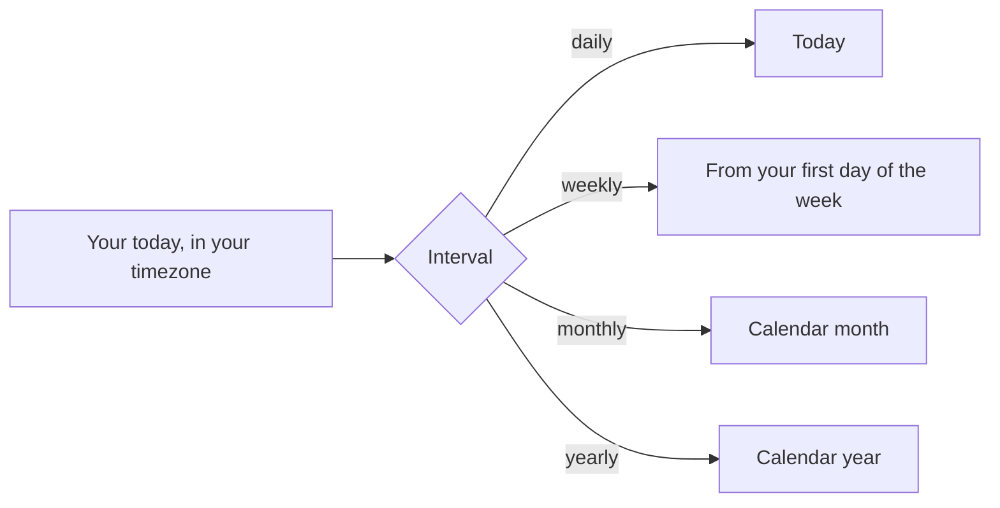

# Goals

A goal is a target for a period, such as "run 40 km every week" or "ride 4 times a month". Endurain measures it against your activities and shows how far along you are. Manage goals under **Settings → My goals**; progress also appears on your profile page.

## What a goal is made of

| Part | Choices |
| ---- | ------- |
| Interval | Daily, weekly, monthly or yearly |
| Activity group | Run, bike, swim, walk, strength or cardio |
| Metric | Calories, number of activities, distance, elevation gain or duration |
| Target | A number for the chosen metric |

You can have several goals, for example a weekly distance goal and a monthly activities goal for the same group.

## Which activities count

Each group counts a set of [activity types](../integrate/supported-types.md):

| Group | Counts |
| ----- | ------ |
| Run | Run, trail run, virtual run, track run, treadmill run |
| Bike | Road, gravel, MTB, virtual, commuting, mixed surface, indoor, e-bike and e-mountain bike rides |
| Swim | Indoor and open water swimming |
| Walk | Walk, indoor walk, hike and snow shoeing |
| Strength | General workout and strength training |
| Cardio | Crossfit, cardio training, HIIT and jump rope |

An activity you [hid from everyone](activities.md#visibility-and-hiding-details), including one Endurain hid because it looked like a duplicate import, does not count. This keeps a file imported twice from counting twice.

## How progress is measured

Progress is the total of the metric over the current period divided by the target, capped at 100 %.

- **Calories, distance, elevation gain:** the sum over the period.
- **Number of activities:** the count.
- **Duration:** the sum of the activities' elapsed time, which includes pauses.

The period follows your calendar:

Both the day and the start of the week come from your profile: the **timezone** and the **first day of the week**. Weekly goals reset on that day, and daily goals roll over at your midnight, not the server's.

Distance and elevation targets are entered in your units (km or miles, metres or feet) and stored in metres.
