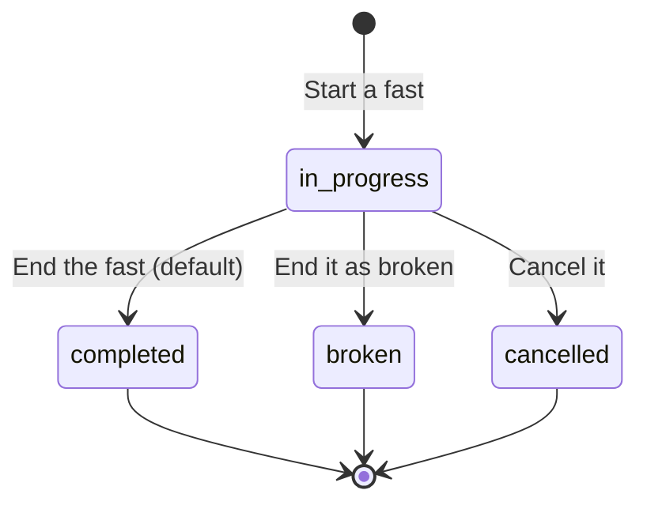

# Health tracking

The Health area keeps daily records next to your activities: weight, steps, sleep, water, bowel movements and fasting. Each metric has its own page, a history you can filter, and an optional target. The Health dashboard shows today at a glance.

Health records belong to your account. Unlike activities, they have no visibility setting or public link.

## Your day is your timezone

"Today" means your calendar day, in the timezone set in your profile. A record added without a date is stored on your today. If your timezone is wrong, a late-evening record can land on the wrong day, so set it first under **Settings → My profile**.

## The metrics

| Metric | What a record holds | Records per day |
| ------ | ------------------- | --------------- |
| Weight | Weight in kg, and optionally body fat, body water, bone mass, muscle mass, visceral fat, physique rating and metabolic age | One |
| Steps | Step count | One |
| Sleep | Start and end, total, deep, light, REM and awake time, awakenings, stress, heart rate, SpO2, respiration, HRV status and the [sleep scores](sleep-scoring.md) | One |
| Water | A total in millilitres | One total, built up by intakes |
| Bowel movements | Date and time, [Bristol stool type](#bowel-movements) 1–7, colour and notes | Any number |
| Fasting | Start, end, protocol, target duration, status and notes | One running fast at a time |

For weight, steps and sleep, adding a second record for a date that already has one is refused with a conflict. Edit the existing record instead.

Records come from you or, for weight, steps and sleep, from a [Garmin Connect sync](integrations.md#garmin-connect). The record keeps its source.

## The dashboard

The dashboard reads each metric for your today and shows only what exists:

| Card | Shows |
| ---- | ----- |
| Sleep | Total sleep, resting heart rate, HRV status and skin temperature deviation. It appears only when the night has an HRV status |
| Weight | Your latest weight and BMI, not only today's |
| Steps | Today's steps |
| Fasting | The running fast, if any |
| Water | Today's total |
| Bowel movements | Today's count |

A card with no data is empty rather than zero.

## Weight and BMI

BMI is worked out from the weight and the height in your profile when you do not supply one. Without a height there is no BMI. When you change your height, the stored BMI of your weight records is recalculated.

## Water

Water is a running total for the day. Logging 250 ml adds 250 to the day's total, and creates the day's record if it is the first one.

## Bowel movements

Each movement is its own record. The Bristol type runs from 1 (separate hard lumps) through 4 (smooth, soft sausage, the ideal) to 7 (liquid). The colour is one of brown, dark brown, light brown, yellow, green, black, red or white. Treat this as a personal log, not medical advice.

## Fasting

You can have one running fast. Starting another while one runs is refused: finish or cancel the first.

Pick a protocol when you start: `16:8`, `18:6`, `20:4`, OMAD, `24h`, `36h`, `48h`, `72h` or custom. The web form pre-fills the target duration from the protocol, and you can change it.

The fasting page also shows statistics over your history:

| Statistic | Meaning |
| --------- | ------- |
| Total fasts | Completed fasts |
| Current streak and longest streak | Consecutive days with a fast |
| Average duration | Mean length of your fasts |
| Total fasting time | All time spent fasting |
| Completion rate | Percentage of started fasts that were completed |

## Targets

Set a target for any metric under the metric's page: weight (kg), daily steps, sleep duration, fasting duration, daily water (ml) and daily bowel movements. Targets appear as goal lines in the charts. They are stored together, and changing one keeps the others.

## History

Every metric page lists records newest first and filters them to the last 7, 30 or 90 days, the last year or all time. The page size is the server's **Records per page** setting.

## Editing at the same time on two devices

Each record carries a version. If you save a record that you opened before it changed elsewhere (another device, or a Garmin sync that updated the day), the save is refused with a message that the record changed. Reload and try again. API clients see this as `412`; see [Errors, concurrency and rate limits](../integrate/errors-and-limits.md#concurrent-edits-with-etag-and-if-match).
