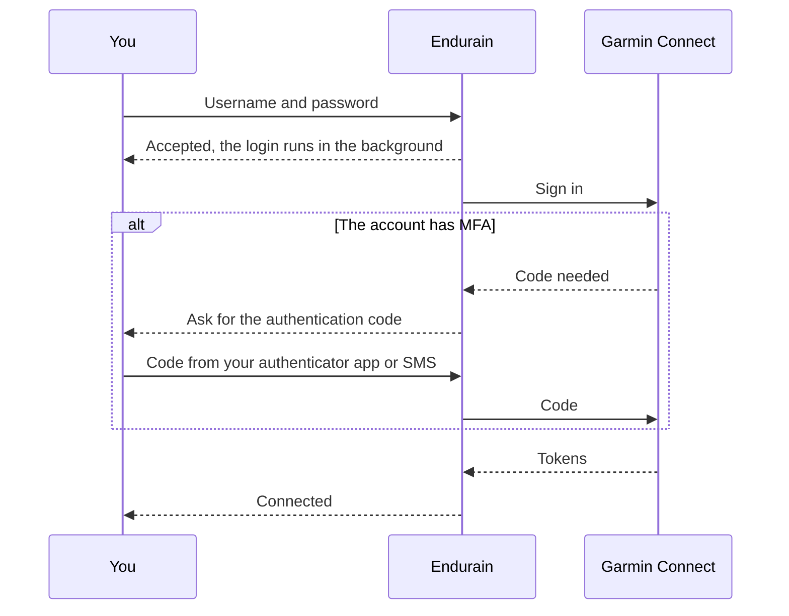
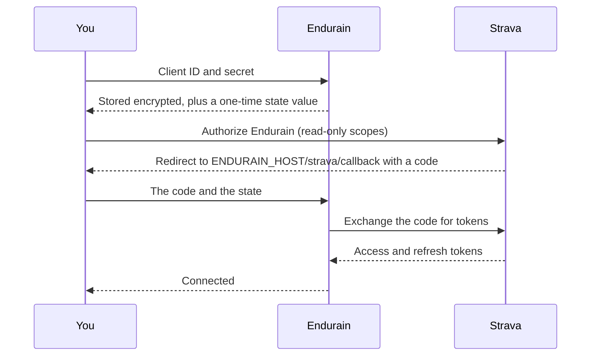

# Integrations

Endurain works with other apps and services. For building your own integration, see the [Integrate](../integrate/authentication.md) section.

## RunnerUp

[RunnerUp](https://github.com/jonasoreland/runnerup), an app for tracking your sport activities with your Android phone, can automatically sync your activities recorded with it to your Endurain instance.

RunnerUp currently **does not** support login with MFA.

## Gadgetbridge

[Gadgetbridge](https://gadgetbridge.org/) is an Android app for wearables. It signs in to Endurain through the system browser using SSO and a custom redirect scheme. An administrator must allow that scheme by adding `gadgetbridge` to `ALLOWED_REDIRECT_SCHEMES` (for example `endurain,gadgetbridge`); see [advanced setup](../getting-started/advanced-setup.md) and [OAuth/SSO and PKCE](../integrate/oauth-sso-pkce.md).

## Garmin Connect

Garmin Connect sync imports activities, gear and health data (body composition, daily steps and sleep). Endurain uses the [python-garminconnect](https://github.com/cyberjunky/python-garminconnect) module.

### Connecting

Open **Settings → Integrations → Garmin Connect → Connect** and sign in with your Garmin Connect email or username and password. Tick the China option if your account is on connect.garmin.cn.

- Your **password is not stored**. Endurain keeps the authentication tokens Garmin returns, encrypted, similar to the Strava integration. The login is sent from the browser to the server as plain text inside the request, so use HTTPS.
- The login runs in the background, and the page follows its progress. Only one attempt per user can run at a time. A second one is refused until the first finishes.
- A failed attempt says why: wrong credentials, wrong MFA code, too many requests (wait a while) or an internal error.
- If Garmin later rejects the stored tokens, Endurain unlinks the account, sends you a [notification](notifications.md) and you connect again. Your imported data is kept.

### What syncs and when

| What | Automatically | On request |
| ---- | ------------- | ---------- |
| Activities | On startup and every hour, the last 24 hours | **Retrieve activities**, for the last N days or a date range |
| Health data | On startup and every 4 hours, the last day | **Retrieve health data**, for a range of at most 31 days |
| Gear | Never | **Retrieve gear** |

The buttons start a background job and return at once. A sync of a kind that is already pending is refused, and you can start only a few syncs per minute, because each one makes several calls to Garmin. Health data is imported as it is: Endurain does not calculate [sleep scores](sleep-scoring.md) for sleep that comes from Garmin Connect.

Duplicates are skipped by Garmin's activity id, so retrieving the same range twice is safe. See [Importing data](importing.md#duplicate-detection).

### Disconnecting

**Disconnect** removes the stored tokens and the gear sync setting. Everything already imported is kept.

## Strava

!!! warning
    Due to Strava API changes, expect changes in the Strava integration in a future release.

Strava needs an API application of your own, because Strava limits each application. Every Endurain user connects with their own application's client ID and secret.

### Before you connect

1. Your Endurain must be reachable from the internet over **HTTPS**, and `ENDURAIN_HOST` must be that public address. Strava sends your browser back to `ENDURAIN_HOST/strava/callback`.
2. Create an API application in your Strava settings (see Strava's [getting started guide](https://developers.strava.com/docs/getting-started/)). Set its **Authorization Callback Domain** to the host of your Endurain, for example `endurain.example.com`.
3. Copy the application's **Client ID** and **Client Secret**.

### Connecting

Open **Settings → Integrations → Strava → Connect**, enter the client ID and secret, and authorize on Strava. You return to Endurain, which finishes the connection. Endurain asks only for read access (`read`, `read_all`, `profile:read_all`, `activity:read`, `activity:read_all`). The tokens are stored encrypted, and so are your client ID and secret. If the exchange fails, Endurain clears what it stored so you can start again.

### What syncs and when

| What | Automatically | On request |
| ---- | ------------- | ---------- |
| Activities | On startup and every hour, the last 24 hours | **Retrieve activities**, for the last N days or a date range |
| Gear | Never | **Retrieve gear** |

Strava's rate limits are per application. When one is hit, Endurain stops calling Strava for every user of the server until it expires, and tells you to try again later. Duplicates are skipped by Strava's activity id. To bring in your whole history, use a [Strava bulk export](importing.md#importing-data-from-a-strava-bulk-export-beta) instead of syncing.

### Disconnecting

**Disconnect** first asks Strava to revoke Endurain's access, and goes ahead even if Strava cannot be reached. It then **deletes the gear and activities that carry a Strava id**, which includes those imported by a sync and those from a [Strava bulk export](importing.md#importing-data-from-a-strava-bulk-export-beta), in line with Strava's [API Agreement](https://www.strava.com/legal/api). It also clears the stored tokens, client ID and secret. Activities from other sources, such as an upload or Garmin Connect, stay.

!!! warning
    Disconnecting Strava cannot be undone. [Export your data](export-import.md) first if you want a copy of what was imported.
