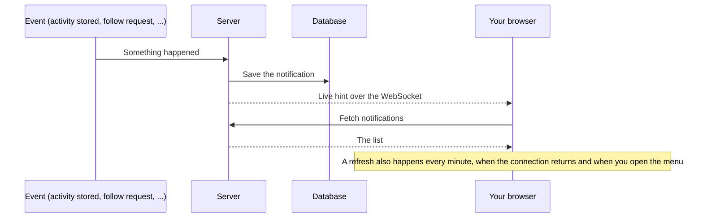

# Notifications

Notifications tell you that something happened that you did not do yourself on the page you are looking at. They appear in the bell menu in the navigation bar, with a count of the unread ones.

## What you are notified about

| Notification | Who gets it | When |
| ------------ | ----------- | ---- |
| New activity | The activity's owner | An activity has been imported, uploaded or synced and stored |
| Duplicate activity | The activity's owner | A stored activity has the same start time as one you already have. It was kept but [hidden](activities.md#changing-an-activity); open it to unhide it if it is not a duplicate |
| New follower request | The user being followed | Someone asked to follow you |
| Follower request accepted | The user who asked | Someone accepted your request |
| Garmin Connect disconnected | The account owner | Garmin Connect rejected your stored login during a sync. Endurain unlinked the account, and you must [connect it again](integrations.md#garmin-connect) |
| Sign-up waiting for approval | Every administrator | A new user verified their email and needs [approval](user-management.md#approving-sign-ups) |

If someone withdraws a follow request, the "new follower request" notification it left behind is removed.

## Reading and clearing

Open a notification to mark it read, or mark them all read from the menu. Read notifications are deleted after the **read notification retention** period, 90 days by default. Unread ones are never deleted. An administrator can change the period, or set it to 0 to keep read notifications forever, in **Settings → Server settings → Data retention**.

## How they reach you

A notification is first saved, and then a small message tells your open browser tab to fetch the list again.

The live message is only a hint and is allowed to be lost. The saved notification is the record, so a missed hint delays the bell by at most a minute. For the message format see [Realtime updates](../integrate/realtime.md).

A notification is created at most once per event. If the event is delivered twice, for example after a restart, you do not get a duplicate.

Notifications are created in the background after the event. On a busy server they can arrive a few seconds late, and if a notification is dropped under load it is not recreated. See [Background work and failure handling](../getting-started/background-work-by-module.md#notifications).
