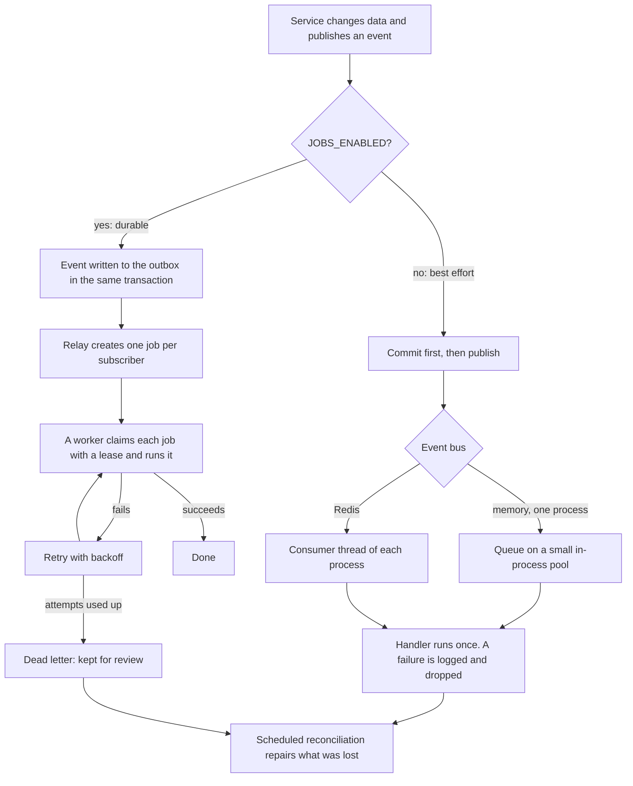
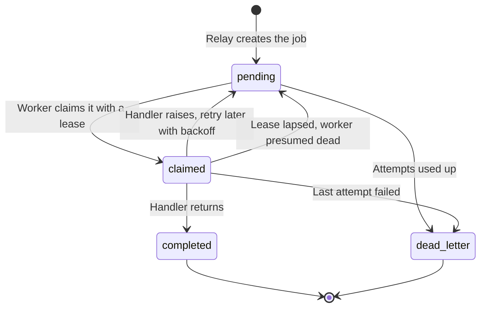
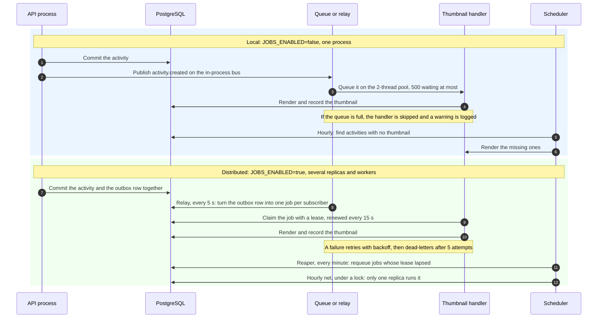
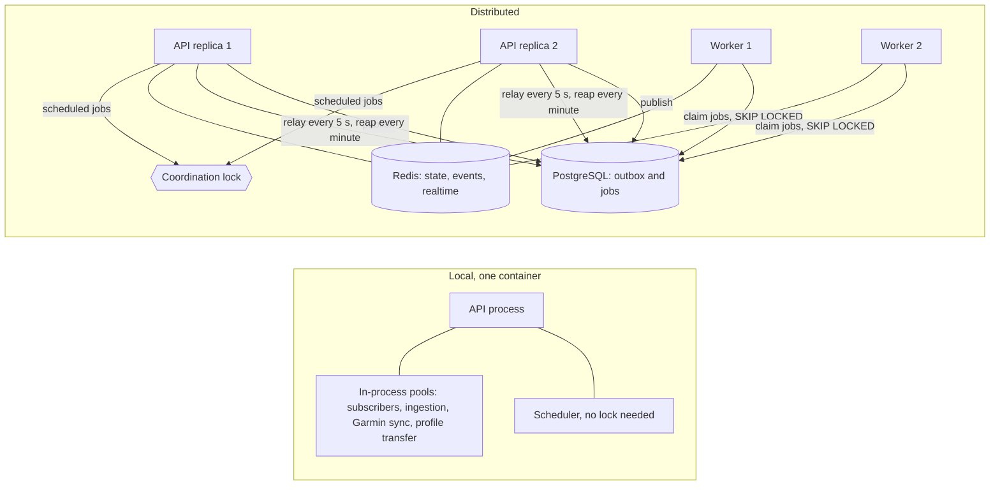

# Background work and failure handling

Endurain does some work after a request has returned: map thumbnails, reverse geocoding, notifications, emails, imports and provider syncs. This page explains how that work is delivered, what happens when it fails or is dropped, and how each module behaves on a single process versus a distributed deployment.

For the settings that choose the mode, see [Scaling and background jobs](scaling-and-background-jobs.md). For how to write a subscriber, see [Events and subscribers](../developer-guide/events-and-subscribers.md).

## Two kinds of background work

The distinction explains most of the behaviour below.

| Kind | Example | If it is lost |
| ---- | ------- | ------------- |
| **Derived work** reacts to something that already happened and can be recomputed from the database | A thumbnail, a location, deleting a file after an activity is deleted | A scheduled job later finds what is missing and repairs it |
| **A command** is something a user asked for | An import, an upload, a provider sync, an email | Nothing repairs it. Its result is recorded on a job or state record, a failure is shown to the user, and the user starts it again |

Every piece of derived work has a reconciliation net, a scheduled job that repairs lost work. Commands deliberately have none; their module says why in `subscriber_registry.py`, and the reasons are summarised in the table per module below.

## How an event is delivered

An event is a fact such as `activity.created`. The module that causes it publishes it in the same step as the change. What happens next depends on `JOBS_ENABLED` and the event bus.

Two points are easy to miss:

- **Durable:** the outbox row is committed with the data, so an event cannot be lost between "the activity was saved" and "something was told". If the transaction rolls back, the event goes with it.
- **Best effort:** the event is published after the commit. If the process dies in between, or a handler fails, nothing retries it. A handler that raises is logged and swallowed so that it can never break the request that caused the event.

Handlers must therefore be idempotent (delivery is at least once on the durable path) and must not assume they ran (best effort can lose them).

### What the durable path guarantees

| Behaviour | Value |
| --------- | ----- |
| Attempts before a job is dead-lettered | `JOBS_MAX_ATTEMPTS`, 5 |
| Wait before a retry | `JOBS_BACKOFF_BASE_SECONDS` (5 s), doubling each attempt, up to `JOBS_BACKOFF_MAX_SECONDS` (1 hour) |
| A job claimed by a worker that goes silent | Requeued once its lease (`JOBS_LEASE_SECONDS`, 300 s) lapses. A running worker renews it every 15 s. The reaper runs every minute |
| A single job that runs too long | Abandoned after 30 minutes and handed to the reaper, even if its worker is healthy |
| A dead-lettered job | Kept for review. Never pruned automatically |
| Completed jobs and relayed outbox rows | Pruned after `JOBS_RETENTION_DAYS`, 90 days |

### What happens when a job dead-letters

For derived work, nothing more: the reconciliation net will fill the gap. For a **command** a user is waiting on, the module registers an `on_dead_letter` callback that closes the user-visible state, so the user sees "failed" instead of "processing" until a timeout. Those are:

- activity uploads, provider refreshes and bulk imports (the job is marked failed),
- Garmin Connect syncs (the sync state becomes failed, so another can be queued),
- profile imports and exports (the state becomes failed).

The callback also runs when the job died without raising, for example a worker killed mid-job, whose own error handling never ran.

## The same event, two deployments

The delivery flowchart above shows the choices. This is what actually runs, step by step, when an activity is stored, side by side. The settings that select each column are in [Scaling and background jobs](scaling-and-background-jobs.md#settings), and the topologies are drawn in [How events are delivered](scaling-and-background-jobs.md#how-events-are-delivered).

The processes involved differ too:

What each part does:

| Part | Runs where | Job |
| ---- | ---------- | --- |
| Outbox | PostgreSQL | Holds an event, committed in the same transaction as the change that caused it |
| Relay | Every API process, every 5 s | Fans an outbox row out into one job per subscriber. Safe on several replicas: it coordinates with `SELECT ... FOR UPDATE SKIP LOCKED` and the fan-out is idempotent |
| Worker | The API process (`JOBS_RUN_IN_PROCESS_WORKER=true`) or a dedicated `APP_ROLE=worker` container | Claims jobs with a lease and runs the handlers. Workers compete for jobs, so adding workers adds throughput |
| Reaper | Every API process, every minute | Requeues jobs whose lease lapsed, and abandons a job that has run for 30 minutes |
| Scheduler | Every API process | Runs the [scheduled jobs](#scheduled-jobs). Jobs with a lock run on one replica per interval |
| Event log | PostgreSQL | One row per event and subscriber for diagnostics, pruned after `EVENT_LOG_RETENTION_DAYS` |

Workers do not run the scheduler, the relay or the reaper, so with `JOBS_RUN_IN_PROCESS_WORKER=false` at least one API process must stay up for jobs to be relayed. Workers do not apply database migrations either, so start the API first.

## When something is dropped

| Situation | What happens | How it is repaired | How you see it |
| --------- | ------------ | ------------------ | -------------- |
| The in-process subscriber queue is full (500 waiting) | The subscriber is skipped | The reconciliation net of that module | WARNING `Dropped an event subscriber: the subscriber pool is full` |
| A best-effort handler raises | Logged and ignored. No retry | The reconciliation net, or the user retries a command | ERROR with the traceback |
| The process stops with work queued on an in-process pool | The queued work is lost | Derived work: the nets. Commands: the user retries | Nothing is logged for work that never started |
| A bounded local pool for a command is full (uploads, imports, syncs, Garmin link, profile import and export) | The request is refused **before** anything is staged, with `503` and a message to try again shortly | The client retries | `503 Too many <name> jobs in progress` |
| The pool fills between accepting the request and starting the job | The job is closed as failed instead of left pending | The user retries | Logged, and the job shows failed |
| A durable job fails every attempt | Dead-lettered, and the user-visible state is closed | A net for derived work, or the user retries | Row in `jasil_processing_jobs` with status `dead_letter` |
| Redis is down while a realtime hint is sent | The hint is lost | The client refetches (every minute, on reconnect, when the menu opens) | DEBUG log |
| A notification's handler is dropped | The notification is not created, and not recreated later | None: notifications have no net | WARNING for the dropped subscriber |

Notifications are the one derived item without a repair, on purpose: the activity or follow row is the source of truth and the notification is a transient signal.

## Scheduled jobs

Recurring jobs are declared by each module and run by the scheduler of the API process. Most hold a named lock, so only one replica runs them.

| Job | Every | Lock | What it does |
| --- | ----- | ---- | ------------ |
| Generate missing thumbnails | 60 min | no | Net for thumbnail generation |
| Remove orphaned thumbnails | 24 h | yes | Net for thumbnail cleanup |
| Backfill missing locations | 60 min | yes | Net for reverse geocoding |
| Remove orphaned retained activity files | 24 h | yes | Net for file cleanup |
| Remove orphaned activity photos | 24 h | yes | Net for photo cleanup |
| Queue a provider refresh for every user with Strava or Garmin linked | 60 min | no | Fan-out, one job per user |
| Fail ingestion jobs that stopped progressing | 60 min | no | Closes jobs stuck in processing |
| Prune ingestion job records | 24 h | no | Retention |
| Remove staged ingestion blobs nothing reads | 24 h | no | Cleanup |
| Pull the last day of Garmin Connect health data | 4 h | yes | One sync per linked user |
| Remove staged profile imports and exports | 6 h each | yes | Cleanup |
| Purge read notifications past retention | 24 h | yes | Retention |
| Authentication clean-ups (reset and sign-up tokens, OAuth states, link tokens, sessions, rotated tokens, pending MFA) | 1 to 60 min | no | Delete what has expired |
| Refresh trusted-proxy hostnames | 1 min | no | Keeps `TRUSTED_PROXIES` names current |
| Prune event log, outbox and job bookkeeping | 24 h | yes | Retention |

A job with a lock uses the platform's coordination lock. With the default `noop://` lock on one process it always runs. With several processes the default is `postgres-advisory://`, and a replica that does not get the lock skips that run and logs it at DEBUG. A job without a lock may run on every scheduler process, so it is written to be safe to repeat.

Strava has no scheduled job of its own: its hourly pull is the provider refresh fan-out above.

Startup also queues a catch-up run of the thumbnail, location, provider refresh and Garmin health jobs, so a restart does not wait a full interval.

## Module by module

Each section says what triggers the work, what happens locally and when distributed, and what is lost if it is dropped. "Distributed" here means `DEPLOYMENT_PROFILE=distributed`, which requires `JOBS_ENABLED=true`, Redis, S3 and a shared lock. A multi-worker local deployment sits between the two: the shared state moves to Redis but the other rules are the local ones unless you also enable durable jobs.

### Activity thumbnails

| | |
| --- | --- |
| Triggers | `activity.created` (render), `activity.deleted` (remove), and a change of the tile server (re-render everything, when that option is on) |
| Local | The handler runs on the 2-thread subscriber pool, after the request has returned. A map needs tiles, so a slow tile server delays only thumbnails |
| Distributed | One durable job per subscriber on a worker, with retries. Thumbnails are written to the bucket |
| If dropped | The hourly net renders any activity that still has no thumbnail. The daily sweep removes thumbnails whose activity is gone. The tile-change re-render has no net: it is an admin command, so repeat the settings save |

### Reverse geocoding

| | |
| --- | --- |
| Trigger | `activity.created` |
| Local | Runs on the subscriber pool, throttled by the geocoding rate limit |
| Distributed | Durable job with retries |
| If dropped | The hourly backfill fills in activities that still have no location, in batches that respect the rate limit |

### Retained files and activity photos

| | |
| --- | --- |
| Trigger | `activity.deleted` |
| Local | The handler deletes the blobs on the subscriber pool |
| Distributed | Durable job |
| If dropped | A daily sweep lists the storage area and removes blobs whose activity no longer exists |

### Notifications

| | |
| --- | --- |
| Triggers | `activity.created`, follower requested, accepted and removed |
| Local | Created on the subscriber pool. A hint then goes to the browser in the same process |
| Distributed | Durable job. The hint travels over the Redis channel to whichever replica holds your socket |
| If dropped | The notification is not created and not recreated. The creation is idempotent, so a redelivered event does not duplicate it |

### Emails: sign-up and password reset

| | |
| --- | --- |
| Triggers | A sign-up verification, an approval request to administrators, an approved notice, a password reset request |
| Local | The email is sent from the subscriber pool. A failed send is logged and not retried |
| Distributed | Durable job. A failed send is retried with backoff, which is why [email retries](advanced-setup.md#supported-environment-variables) need `JOBS_ENABLED=true` |
| If dropped | Nothing repairs it. A lost reset email is recovered by requesting another, a lost verification email by signing up again or an administrator. The user and token rows stay the source of truth |

### Activity uploads, provider refreshes and bulk imports

These are commands. Their state lives on an ingestion job row, which the client polls.

| | |
| --- | --- |
| Local | After the job row is committed, the work runs on a 2-worker pool that holds up to 100 jobs. A full pool refuses the request with `503` before a job row exists |
| Distributed | The job row and the outbox event commit together and a worker runs the job. A bulk import runs in short batches and queues its own continuation so large imports interleave with other work. A crash resumes from the saved position |
| Fan-out | Every hour one refresh job is queued per user who linked Strava or Garmin Connect. A user whose previous refresh is still running is skipped |
| If dropped | A job that stops progressing is failed by the hourly reaper (after 24 hours without progress). A dead-lettered job is closed as failed. The user uploads or starts the import again. Re-running is safe: duplicate detection skips what was already imported |

### Garmin Connect

| | |
| --- | --- |
| Linking | The login runs in the background on a pool of 4. The attempt's status (pending, MFA required, completed, failed) lives in the shared state, so any replica can answer the status poll. The MFA code is passed through the same shared state. A second attempt while one runs is refused with `409` |
| Gear and health syncs | Local: a 2-worker pool holding up to 50. Distributed: a durable job. Only one sync of a kind per user at a time (`409` otherwise) |
| Recurring | Every 4 hours, one health sync per linked user, under a lock, so replicas do not repeat it |
| If dropped | A failed sync is marked failed so another can be queued. A dead-lettered sync is closed the same way. The recurring pull covers the last day again |

### Profile import and export

These are commands with a state record the client polls (an import's state lives 4 hours, an export's 2 hours).

| | |
| --- | --- |
| Local | Run on a dedicated pool of 1 worker holding 3 jobs, apart from the subscriber pool, because an archive can take minutes. A full pool refuses the request with `503` before the archive is staged |
| Distributed | Durable job. The staged archive is in the bucket, so any worker can take it |
| If dropped | A job the pool could not take is closed as failed and its archive removed. Unused staged archives are swept every 6 hours. The user starts again |

### Server settings

A change to the tile server publishes `server_settings.tile_settings_changed` in the same transaction as the save, and the thumbnail module reacts. The settings are cached for a few seconds in each process, and the content security policy for a new tile domain reaches the other replicas within about 30 seconds.

### Followers and activities

These modules publish events and subscribe to none. `activity.created`, `activity.updated` and `activity.deleted` and the follower events are consumed by the modules above.

### Realtime hints

Delivered best effort over the WebSocket, and over a Redis channel when several processes run. See [Realtime updates](../integrate/realtime.md).

## Subscriber catalog

Every durable job is one subscriber reacting to one event. The **subscriber id** is what you see in `jasil_processing_jobs.subscriber_id` and `jasil_event_log.handler_name`, and it is stable across refactors, so you can filter on it. See [Troubleshooting](troubleshooting.md#inspect-background-jobs-durable-jobs-only) for the queries, and [Events and subscribers](../developer-guide/events-and-subscribers.md#register-it) for how an id is chosen.

"Runs without durable jobs" says where the handler runs when `JOBS_ENABLED=false`. A **bus** handler is queued on the 2-thread subscriber pool and a failure is dropped. A **command pool** is a bounded pool that the request submits to directly, described in the module's section above.

| Subscriber id | Event | Runs without durable jobs | Repaired by | On dead-letter |
| ------------- | ----- | ------------------------- | ----------- | -------------- |
| `activity_thumbnail.generate` | `activity.created` | Bus | [Hourly missing-thumbnail job](#scheduled-jobs) | Net fills the gap |
| `activity_thumbnail.cleanup` | `activity.deleted` | Bus | Daily orphan sweep | Net fills the gap |
| `activity_thumbnail.settings_changed` | `server_settings.tile_settings_changed` | Bus | Nothing: repeat the settings save | Nothing |
| `activity_geocoding.reverse_geocode` | `activity.created` | Bus | Hourly location backfill | Net fills the gap |
| `activity_file_storage.cleanup` | `activity.deleted` | Bus | Daily orphan sweep | Net fills the gap |
| `activity_media.cleanup` | `activity.deleted` | Bus | Daily orphan sweep | Net fills the gap |
| `activity.notify_created` | `activity.created` | Bus | Nothing, by design | Nothing |
| `followers.notify_requested` | `follower.requested` | Bus | Nothing, by design | Nothing |
| `followers.notify_accepted` | `follower.accepted` | Bus | Nothing, by design | Nothing |
| `followers.clear_request_notification` | `follower.request_removed` | Bus | Nothing, by design | Nothing |
| `auth.send_sign_up_verification_email` | `auth.sign_up_verification_requested` | Bus | The user signs up again, or an administrator helps | Nothing |
| `auth.send_sign_up_approval_request_email` | `auth.sign_up_approval_requested` | Bus | Administrators also see the pending user and a notification | Nothing |
| `auth.send_sign_up_approved_email` | `auth.sign_up_approved` | Bus | Nothing: the email is a courtesy | Nothing |
| `auth.send_password_reset_email` | `auth.password_reset_requested` | Bus | The user requests another reset | Nothing |
| `users.profile_import_requested` | `users.profile_import_requested` | Bus, then the profile transfer pool | The user starts again | Import state closed as failed |
| `users.profile_export_requested` | `users.profile_export_requested` | Bus, then the profile transfer pool | The user starts again | Export state closed as failed |
| `activity_ingestion.uploaded_file` | `activity.file_uploaded` | Ingestion command pool | The user uploads again | Job marked failed |
| `activity_ingestion.refresh_requested` | `activity.refresh_requested` | Ingestion command pool | The hourly refresh fan-out, or the user | Job marked failed |
| `activity_ingestion.bulk_import` | `activity.bulk_import_continue` | Ingestion command pool | Resumes from its saved position. The stale-job reaper closes one that stops progressing | Job marked failed |
| `garmin.sync_requested` | `garmin.sync_requested` | Garmin sync pool | The 4-hourly health pull, or the user | Sync state marked failed |

Three things follow from the table:

- A handler that **has a repair job** is derived work. Losing one costs time, not data.
- A handler that **repairs nothing** is either a command the user can repeat or a transient signal such as a notification. Each of these says why in its module's `subscriber_registry.py`, and a test fails if a durable subscriber declares neither a repair job nor a reason.
- The ingestion and Garmin commands have **no bus subscriber**. Without durable jobs the service hands them to its own bounded pool instead, which is why a full pool answers the request with `503`.

The realtime hint to the browser is not a job. It is delivered over the WebSocket and, with several processes, over a Redis channel; see [Realtime updates](../integrate/realtime.md#local-and-distributed-deployments).

## Reading the table in practice

| You run | Expect |
| ------- | ------ |
| One container, defaults | Derived work follows within seconds. A restart can drop queued thumbnails and locations, and the hourly jobs fill them in. Commands that were queued are lost on restart, and their users retry |
| A few web workers, local | Same, with shared state in Redis so limits and live updates work across workers |
| Durable jobs on one host | Retries, a dead-letter list you can inspect and no loss of an event between save and publish. A worker restart costs a delay, not the work |
| Distributed | The above on several hosts, with locks so each scheduled job runs once and a bucket so any replica can serve any file |

If something did not appear, look in this order: the logs for the module's warning, the [job tables](troubleshooting.md#inspect-background-jobs-durable-jobs-only) on the durable path, and then wait for the next run of the module's scheduled net.
