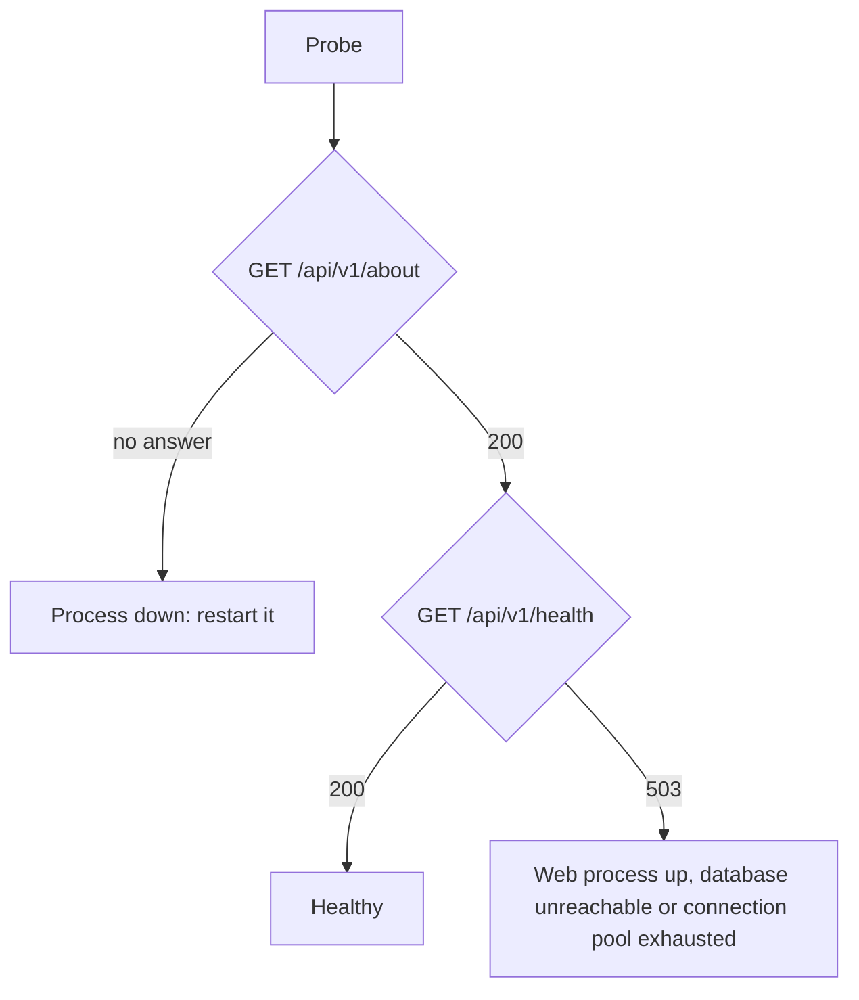

# Monitoring

This page covers how to tell whether Endurain is healthy, where its logs go and what to watch. Endurain has no metrics endpoint: the signals are the two health endpoints, the logs and a few database tables.

## Health endpoints

Both are unauthenticated and need no `X-Client-Type` header.

| Endpoint | Checks | Fails with |
| -------- | ------ | ---------- |
| `GET /api/v1/about` | That the web process is up. Returns the name, version and licence | Nothing but a dead process |
| `GET /api/v1/health` | That a database connection can be obtained and answers `SELECT 1`. Returns `{"status": "ok"}` | `503` when the pool is exhausted or the database is unreachable |

The container image's own `HEALTHCHECK` calls `/api/v1/about` every 30 seconds, with a 120 second start period. That tells Docker the process runs, not that the database works. For a load balancer or an orchestrator that should stop sending traffic to a wedged instance, probe `/api/v1/health` instead.



Neither endpoint says anything about background work. A worker that has stopped, or a queue that is backing up, shows only in the [job tables](troubleshooting.md#inspect-background-jobs-durable-jobs-only) and the logs.

## Logs

| Where | What |
| ----- | ---- |
| Container output (stdout) | One JSON object per line, in `production` and `demo` |
| `app.log` in `LOGS_DIR` | The same records. In `development` it is human-readable text |
| Uvicorn access log | Off unless `LOG_ACCESS=true` |

Set the level with `LOG_LEVEL` (`critical`, `error`, `warning`, `info`, `debug`, `trace`). Raise it to `debug` only while investigating, because debug logs routine work such as every stored record.

`app.log` rolls over at 10 MiB and keeps five old files, but only when a single process writes it. With several web workers, a dedicated worker or several replicas, the file is not rotated, so send the stdout JSON to your platform's log collection instead and keep the file small or off.

### Finding one request

Every response carries an `X-Request-ID` header, and every error body carries the same value as `request_id`. Logs written while handling that request, including those of the background work it started, carry it too. Ask the user for the id, then search for it.

```bash
docker compose logs endurain | grep <request_id>
```

### The log levels

| Level | Means |
| ----- | ----- |
| ERROR | A failure nobody asked for, with its traceback |
| WARNING | A refusal or a degraded path an operator may need to see: a denied caller, a dropped event subscriber, a provider that refused |
| INFO | A change someone would audit: an account created, approved, deleted or linked, settings changed, a background job queued or finished |
| DEBUG | Routine work |

Messages worth alerting on:

| Message | Level | Meaning |
| ------- | ----- | ------- |
| `Dropped an event subscriber: the subscriber pool is full` | WARNING | The in-process queue was full and a thumbnail, notification or cleanup was skipped. A scheduled job repairs it. See [Background work](background-work-by-module.md#when-something-is-dropped) |
| `A <pool> job failed` | ERROR | A job on a local pool raised. The traceback follows |
| `Too many <pool> jobs in progress` | (503 to the client) | A bounded local pool is full, and the request was refused up front |
| Deprecated environment variable(s) detected | ERROR | Startup stops until they are removed |
| `Inconsistent deployment configuration` | ERROR | Startup stops. The message names the setting |

### In the app

Administrators can read the newest records in **Settings → Server settings → Server logs**. It is available only when one process writes the log file, so it is off on the public demo and on multi-process deployments.

## What to watch

- **Database connections.** Each web process holds up to 60. See [Sizing](scaling-and-background-jobs.md#sizing). `/api/v1/health` going `503` under load usually means the pool or PostgreSQL's `max_connections` is exhausted.
- **Dead-lettered jobs** (durable jobs only). `SELECT count(*) FROM jasil_processing_jobs WHERE status = 'dead_letter'`. They are kept for review and never pruned. See [Troubleshooting](troubleshooting.md#inspect-background-jobs-durable-jobs-only).
- **Pending jobs that do not shrink.** On the durable profile with `JOBS_RUN_IN_PROCESS_WORKER=false`, this means no worker is running.
- **Disk space** for `LOGS_DIR` and the data volume, or your bucket's size on object storage. See [Storage and backups](storage-and-backups.md).
- **Mail.** Failed emails are retried only with durable jobs on. A test email in the server settings tells you whether the settings work.
- **Strava.** Its rate limits are per application. When one is hit, syncs stop until it expires and the log says so.
