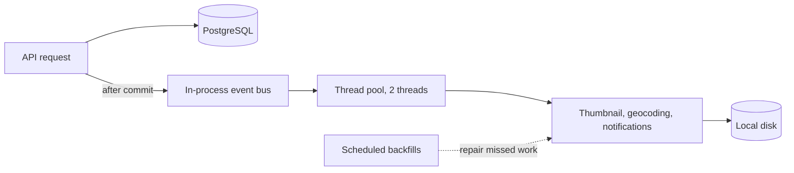
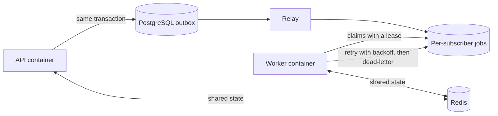
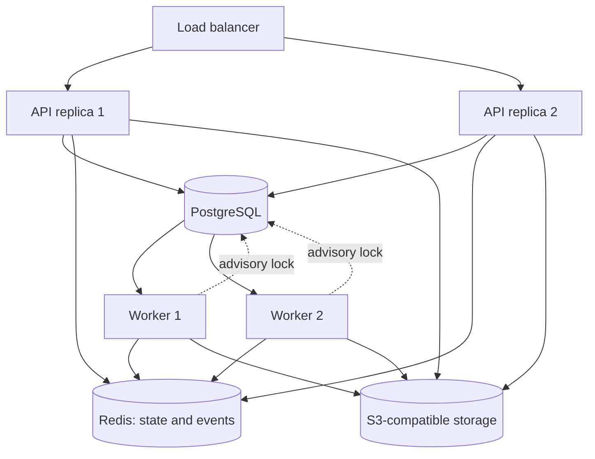

# Scaling and background jobs

Endurain runs as a single process by default. This page explains the settings that change that: where shared state lives, how background work is delivered, and how to run extra web workers or a dedicated job worker.

If you run one container with the default compose file, you do not need to change anything here.

## How background work flows

Some work happens after a request returns: map thumbnails, reverse geocoding, retained source files, imports and notifications. Heart-rate zones are not stored; they are computed from your current max heart rate whenever an activity's streams are read. Endurain publishes an event when something happens (for example an activity is created), and independent subscribers react to it.

| Mode | Setting | Behaviour |
| --- | --- | --- |
| Best-effort (default) | `JOBS_ENABLED=false` | Subscribers run through the event bus. A failure is logged and swallowed; a scheduled backfill later repairs anything that was missed. |
| Durable | `JOBS_ENABLED=true` | Events are written to the database outbox, relayed into per-subscriber jobs, and run by a worker with retry, backoff and a dead-letter state. |

Without a Redis event bus, subscribers run on a small in-process thread pool (two threads) rather than inside the request, so a request never waits for a thumbnail or a cleanup. Work still queued when the process stops is repaired by the scheduled backfills and sweeps.

Every derived-work subscriber also has a scheduled backfill, so a lost event is repaired in either mode. Durable mode makes recovery faster and visible; it is not required for correctness.

## How events are delivered

When an activity is stored, Endurain publishes an event such as `activity.created`. Subscribers (thumbnails, geocoding, notifications) react to it. Where the event goes depends on your settings.

### Default: one process



A failure is logged and swallowed. The backfill repairs anything that was lost, for example after a restart.

### Durable jobs with a dedicated worker



The event is written in the same transaction as the activity, so it cannot be lost. A worker claims jobs with a lease and renews it while it runs. If it dies, the reaper requeues its jobs.

### Distributed



Replicas share no local state: rate limits, login lockout and pending MFA live in Redis, files live in the bucket, and a PostgreSQL advisory lock makes sure a scheduled job runs on one replica at a time.

## Choosing a deployment shape

| Shape | Use when | Needed |
| --- | --- | --- |
| Single process (default) | Home server, one container | Nothing extra |
| Several web workers | One host, more request capacity | `WEB_WORKERS>1` and `REDIS_URL` |
| Distributed | Several hosts or containers behind a load balancer | `DEPLOYMENT_PROFILE=distributed`, `JOBS_ENABLED=true`, Redis, S3-compatible storage, a shared lock |
| Dedicated worker | Keep job processing off the API | `JOBS_ENABLED=true`, `JOBS_RUN_IN_PROCESS_WORKER=false`, `REDIS_URL`, a second container with `APP_ROLE=worker` |

!!! warning "Check your image first"
    The Redis and S3 client libraries ship in the `distributed` extra, which is **not** installed in an image built without it. If you use `REDIS_URL`, `EVENTS_URI=redis://…` or `STORAGE_URI=s3://…`, make sure your image was built with `--build-arg PYTHON_EXTRAS=distributed`.

## Settings

| Variable | Default | Notes |
| --- | --- | --- |
| `DEPLOYMENT_PROFILE` | `local` | `local`, `distributed` or `custom`. Only `local` has defaults; the others must name every capability below. |
| `WEB_WORKERS` | `1` | Number of web-server processes. Above 1 requires shared state and a shared lock. |
| `STATE_URI` | unset | Shared ephemeral state: rate-limit counters, login lockout, pending MFA, MFA setup secrets, Garmin MFA codes, websocket tickets. Falls back to `REDIS_URL`, then `memory://`. |
| `EVENTS_URI` | unset | Event bus. Falls back to `REDIS_URL`, then `memory://` (in-process). `redis://…` uses Redis Streams. |
| `REDIS_URL` | unset | Default DSN for every Redis-backed capability that has no explicit URI. |
| `STORAGE_URI` | `local://` | Where blobs go (thumbnails, media, images, retained files). `local://` uses `DATA_DIR`; `s3://bucket/prefix` uses S3-compatible storage. |
| `LOCK_URI` | profile default | `noop://` (single process) or `postgres-advisory://` (coordinates scheduled jobs across replicas). Defaults to `postgres-advisory://` when more than one process runs. |
| `JOBS_ENABLED` | `false` | Turns on the durable job queue. |
| `JOBS_RUN_IN_PROCESS_WORKER` | `true` | Whether the API process also drains jobs. Set `false` when running dedicated workers, and set it on the API and every worker container: a dedicated worker is a separate process, so the deployment then needs shared state (see [Startup validation](#startup-validation)). |
| `JOBS_MAX_ATTEMPTS` | `5` | Attempts before a job is dead-lettered. |
| `JOBS_BACKOFF_BASE_SECONDS` | `5` | First retry delay; doubles each attempt. |
| `JOBS_BACKOFF_MAX_SECONDS` | `3600` | Retry delay ceiling. |
| `JOBS_LEASE_SECONDS` | `300` | How long a worker may go silent before its jobs are requeued. A running worker renews the lease every 15 seconds, so this is not a limit on how long a job may run. Must be at least 45. |
| `JOBS_BATCH_SIZE` | `10` | Jobs claimed (and outbox rows relayed) per pass. |
| `JOBS_POLL_INTERVAL_SECONDS` | `2.0` | Idle wait between empty polls. |
| `JOBS_RETENTION_DAYS` | `90` | Pruning age for completed job bookkeeping. Dead-lettered and in-flight rows are kept. `0` disables pruning. |
| `EVENT_LOG_ENABLED` | `true` | Record each event's lifecycle in the `event_log` table for diagnostics. |
| `EVENT_LOG_RETENTION_DAYS` | `90` | Pruning age for `event_log`. `0` disables pruning. |
| `APP_ROLE` | `api` | Container role: `api` serves HTTP, `worker` drains the job queue. Requires `JOBS_ENABLED=true`. |

## Startup validation

Endurain refuses to start on an inconsistent topology and names the variable at fault. It rejects:

- `distributed` or `WEB_WORKERS>1` with state or events resolving to `memory://`;
- `distributed` with `STORAGE_URI` unset or `local://`, because replicas do not share a disk;
- `distributed` with `JOBS_ENABLED=false`, because the Redis event bus has no retry and does not recover a crashed consumer's in-flight events; only the durable outbox cannot silently drop them;
- more than one process with `LOCK_URI=noop://`;
- dedicated workers (`JOBS_RUN_IN_PROCESS_WORKER=false` with `JOBS_ENABLED=true`) with state or events resolving to `memory://`, because the API and the workers are separate processes. Every rule above applies to them, even on the `local` profile with one web worker;
- a non-`local` profile that leaves a capability unset.

With `ENVIRONMENT=development` these become warnings instead.

A job worker, in-process or dedicated, also refuses to start when `JOBS_LEASE_SECONDS` is below 45.

## Recipes

### More web workers on one host

```env
WEB_WORKERS=4
REDIS_URL=redis://redis:6379/0
```

Local storage still works because the workers share the host disk. The lock defaults to `postgres-advisory://`.

### Durable jobs with a dedicated worker

```env
JOBS_ENABLED=true
JOBS_RUN_IN_PROCESS_WORKER=false
REDIS_URL=redis://redis:6379/0
```

Set `JOBS_RUN_IN_PROCESS_WORKER=false` for the API and for the worker alike. `REDIS_URL` is required: the API and the worker are separate processes and share state through it. Add a second service from the same image:

```yaml
  endurain-worker:
    image: ghcr.io/endurain-project/endurain:latest
    env_file: .env
    environment:
      APP_ROLE: worker
    depends_on:
      - endurain
```

Start the API first. It applies database migrations at startup, and the worker does not.

### Distributed

```env
DEPLOYMENT_PROFILE=distributed
REDIS_URL=redis://redis:6379/0
STORAGE_URI=s3://my-bucket/endurain
LOCK_URI=postgres-advisory://
JOBS_ENABLED=true
```

Every replica must share the same database, Redis and bucket. Run one or more workers with `APP_ROLE=worker`.

## What to watch

- On a multi-worker `local` deployment whose event bus is Redis and `JOBS_ENABLED=false`, the API logs a warning at startup: delivery is best-effort, with no per-subscriber retry and no recovery of a crashed consumer's in-flight events. The scheduled backfills still repair the results; enable `JOBS_ENABLED` for retries you can see.
- With `JOBS_ENABLED=true` and `JOBS_RUN_IN_PROCESS_WORKER=false`, jobs accumulate unless a worker is running.
- A worker killed mid-job is not noticed instantly: its job is requeued once the lease expires and the reaper (which runs every minute) sees it, so expect it to finish a few minutes late rather than be lost.
- A single job is abandoned after 30 minutes of running, even while its worker is healthy; it is handed back to the reaper like a job whose worker died.
- Dead-lettered jobs are kept for review and are never pruned automatically.

## Sizing

Each web process keeps its own database pool of up to 60 connections (20 plus 40 overflow) and about 40 request threads. A request waits up to 30 seconds for a free connection before it fails.

- Total connections are `60 × (web workers + replicas + dedicated workers)`. Keep that below PostgreSQL's `max_connections` (100 by default), or put PgBouncer in front of the database.
- Each coordination lock held through `postgres-advisory://` keeps one more connection open for as long as the job runs.
- `postgres-advisory://` uses session-level advisory locks, which only work on a connection that stays pinned to one PostgreSQL backend. Behind PgBouncer in transaction pooling mode the lock and its release can land on different backends, so two replicas can both believe they hold it. Point `DB_HOST` at PgBouncer in session mode, or at PostgreSQL directly. Either way the lock is lost if its connection drops mid-job, so every coordinated job is idempotent: the lock only avoids duplicated work.
- A slow job does not need a long lease: the worker renews it while the handler runs, so only a worker that stops responding (a crash, a lost network) loses its jobs. Keep `JOBS_LEASE_SECONDS` comfortably above 45 so a brief stall is not mistaken for a crash.
- S3 requests use the client's default connect and read timeouts (60 seconds) and retry up to three times, so an unreachable bucket can hold a thread for minutes. Prefer a bucket in the same region as the application.
- Leftover work is cleaned up on a schedule: ingestion jobs that stop progressing are failed after 24 hours, and staged uploads and bulk-import archives that no job references are removed after 2 days.

## Strava and Garmin Connect syncs

Every hour Endurain queues one refresh job per user who has linked Strava or Garmin Connect, and each job syncs the last 24 hours for that user (and refreshes their Strava token first). A user whose previous refresh has not finished is skipped, so a backed-up queue does not grow. The same jobs back the "retrieve activities" buttons in settings, which return a job you can poll.

- Each job is independent, so jobs are spread across workers, retried with backoff when durable jobs are enabled, and one slow account cannot hold up the others.
- Strava's rate limits are per application. When one is hit, every process and replica stops calling Strava until it expires; the state is shared through `STATE_URI`.
- Without `JOBS_ENABLED`, the jobs run on the API process's small background pool and are re-queued at the next hourly run if lost in a restart.

## Bulk imports

A bulk import is one job over one staged archive. It runs in short batches (each bounded by a number of files and a fraction of `JOBS_LEASE_SECONDS`); a batch that leaves files over records how far it got and queues its own continuation, which goes to the back of the queue so large imports interleave with other work. A crash resumes from the recorded position. Without `JOBS_ENABLED` the whole import runs on the API process's background pool instead.

Importing from a folder on the server is node-bound: the folder is packed on the instance that received the request, so on a deployment with several API replicas it must be mounted where that request can reach it. Uploading a ZIP has no such requirement.
