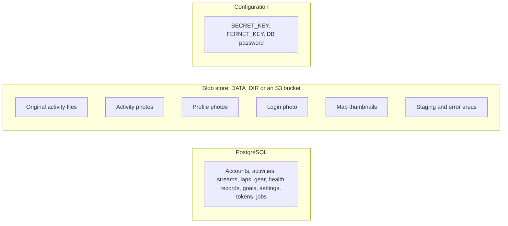

# Storage and backups

Endurain keeps data in three places: the PostgreSQL database, a blob store for files and images, and your configuration (environment variables and secrets). A backup has to cover all three, and it helps to know which files can be rebuilt and which cannot.

## Where things live

The blob store is `local://` by default, which means subfolders of `DATA_DIR` (`/app/backend/data` in the image). With `STORAGE_URI=s3://bucket/prefix` the same areas are key prefixes in an S3-compatible bucket. A `distributed` deployment must use S3, because replicas do not share a disk. See [Scaling and background jobs](scaling-and-background-jobs.md).

### Storage areas

| Area | Holds | Can be rebuilt? |
| ---- | ----- | --------------- |
| `activity_files` | The original uploaded or synced files of activities, kept after import, plus working folders: `bulk_import/<user id>`, `strava_import/<user id>` (the `<user id>` folders are the user's UUID; folders named with an old numeric id are renamed at the first start after the upgrade to v0.21.0), `upload_incoming` and `upload_staging` | No. Keep it |
| `activity_media` | Photos attached to activities | No |
| `user_images` | Profile photos | No |
| `server_images` | The login photo | No, but an admin can upload it again |
| `activity_thumbnails` | Map previews | Yes. A job re-renders any that are missing |
| `profile_import_staging`, `profile_export_staging` | Archives waiting to be imported or downloaded | Temporary |
| `bulk_import_errors` | Files that failed in a bulk import, under `<user id>/<import id>/` | Kept for you to inspect, then removed after `JOBS_RETENTION_DAYS` (90 days by default) or when the account is deleted |

The activity data itself (route, streams, laps, heart rate and so on) is in the database. The original file is retained alongside it and is what a profile export includes.

On local storage every area is browsable under the `data` directory the image creates at start: `activity_files/processed/<activity id>.<ext>` (the activity id is a UUID), `activity_media/`, `activity_thumbnails/`, `user_images/`, `server_images/`, the profile staging areas and `bulk_import_errors/`. The first start of v0.21.0 renames the stored activity files, thumbnails and photos to their new ids (data migration 13). Migration 11 moves files written by earlier releases in the provider's private layout into these paths on startup.

## What to back up

1. **The database.** A `pg_dump` taken while the database runs. Copying the PostgreSQL data folder while the database is writing is not reliable.
2. **The blob store.** `backend/data` on the host for local storage, or the bucket for S3 (enable bucket versioning, or your provider's backup).
3. **Your secrets**, kept apart from the data:
   - `FERNET_KEY` encrypts the Strava and Garmin Connect tokens and credentials, two-step verification (TOTP) secrets, identity provider client secrets, the mail password and the map and geocoding API keys. Lose it and these become unreadable: users must reconnect their accounts and set up two-step verification again, and an admin must re-enter the secrets. To change the key, see [Rotating the encryption key](#rotating-the-encryption-key).
   - `SECRET_KEY` signs login tokens and the links to photos and thumbnails. Lose it and everyone is signed out and old links stop working. Nothing is lost. To change the key without signing anyone out, see [Rotating the signing key](#rotating-the-signing-key).
   - `AUDIT_SIGNING_KEY`, if you set one, signs the audit trail's checkpoints. Lose it and new checkpoints are signed with a new key; keep the old public key to verify the older ones.
   - `DB_PASSWORD`.

The logs (`backend/logs`) are optional to back up.

Take the database dump and the blob copy close together. They can disagree slightly if you take them hours apart: a file with no row is removed by a nightly sweep, and a row whose file is missing simply has no original to show.

## Restoring

1. Restore the database into the PostgreSQL version you run (a major-version change needs a dump and restore, not a file copy).
2. Restore the blob store to the same place and, for local storage, give the container user write access (see [Quick start](quick-start.md#create-directory-structure)).
3. Start Endurain with the same `FERNET_KEY` and `SECRET_KEY` (every key, if you list several).
4. Missing thumbnails and locations are regenerated in the background. Give a large library time.

## Rotating the encryption key

`FERNET_KEY` accepts several keys separated by commas. The first key encrypts, and every key in the list can decrypt. A single key works as before.

1. Generate a new key (see [Secret Generators](../tools.md#secret-generators)).
2. Set `FERNET_KEY=<new key>,<old key>` (or the content of the file `FERNET_KEY_FILE` points to) and restart Endurain.
3. The start-up log reports how many values were rewritten and how many no key could decrypt (those are left untouched). With several replicas, one of them does the work.
4. Wait a few minutes. Values held only briefly (a two-step verification setup in progress, a Garmin Connect verification code) and pagination cursors issued before the restart are not re-encrypted, and need the old key until they expire.
5. Set `FERNET_KEY=<new key>` and restart again.

## Rotating the signing key

`SECRET_KEY` accepts several secrets separated by commas, like `FERNET_KEY`. The first one signs, and every one in the list verifies, so a rotation does not sign anyone out. A single key works as before.

Each login token names the key that signed it (the `kid` header), and the server verifies it with that key. The links to photos, thumbnails and media are checked against every key in the list too.

1. Generate a new key (see [Secret Generators](../tools.md#secret-generators)).
2. Set `SECRET_KEY=<new key>,<old key>` (or the content of the file `SECRET_KEY_FILE` points to) and restart every Endurain process: the web workers, any dedicated worker and every replica. Until they all run with the new list, a token signed with the new key is refused by a process that still has only the old one, so restart them together.
3. Keep the old key in the list for the longest lifetime a token can have. That is the refresh token lifetime, 7 days by default (Settings > Server > Sessions), and 24 hours for the photo, thumbnail and media links.
4. Set `SECRET_KEY=<new key>` and restart again. A session that did not refresh in that time is signed out, and the mailed links and signed URLs issued under the old key stop working.

Replacing the key outright, with no list, signs everyone out in the browser and in mobile apps and breaks the links already handed out; the app gets new ones on the next page load. Use it when the old key leaked and you want its tokens dead at once. Either way, API keys keep working and so do the password reset, sign-up and email change links already mailed, and no data is lost.

The digests of rotated refresh tokens and of CSRF tokens are stored under the first secret, and are looked up and compared under every listed secret. A web client's refresh keeps working after a rotation, and a refresh token that was rotated before it is still recognised as reused.

## What Endurain cleans up by itself

Leftovers do not pile up forever. Scheduled sweeps remove:

| What | When it is removed |
| ---- | ------------------ |
| Thumbnails, photos and retained files whose activity is gone | Daily |
| Staged upload and bulk-import archives that no job references | After about 2 days |
| Staged profile import archives that were never used | A sweep every 6 hours |
| Profile export archives past their download window | A sweep every 6 hours (the download itself is available for 2 hours) |
| Identity provider icons whose provider is gone or has no icon | Daily |
| Ingestion job records past their retention | Daily |
| Failed bulk-import files past the job retention (`JOBS_RETENTION_DAYS`) | Daily |
| Audit trail days older than 90 days | Checked every 5 minutes |

Failed bulk-import files in `bulk_import_errors` are removed after `JOBS_RETENTION_DAYS` (90 days by default), so copy out any you still need before then. Setting `JOBS_RETENTION_DAYS` to `0` keeps them until the account is deleted.

Deleting an activity or an account removes its blobs too, so you rarely need to touch the folders by hand. Do not delete files from `activity_files` or `activity_media` directly: the database would still point to them.

## Moving storage

Changing `STORAGE_URI` points Endurain at a different place and does not copy anything for you. Copy the existing areas to the new location first, with the same folder or prefix names, then change the variable and restart.
