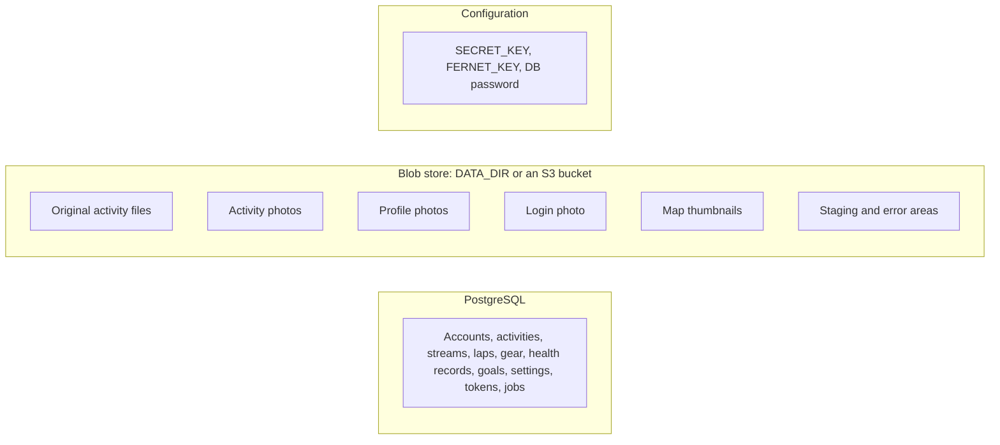

# Storage and backups

Endurain keeps data in three places: the PostgreSQL database, a blob store for files and images, and your configuration (environment variables and secrets). A backup has to cover all three, and it helps to know which files can be rebuilt and which cannot.

## Where things live

The blob store is `local://` by default, which means subfolders of `DATA_DIR` (`/app/backend/data` in the image). With `STORAGE_URI=s3://bucket/prefix` the same areas are key prefixes in an S3-compatible bucket. A `distributed` deployment must use S3, because replicas do not share a disk. See [Scaling and background jobs](scaling-and-background-jobs.md).

### Storage areas

| Area | Holds | Can be rebuilt? |
| ---- | ----- | --------------- |
| `activity_files` | The original uploaded or synced files of activities, kept after import, plus working folders: `bulk_import/<user id>`, `strava_import/<user id>`, `upload_incoming` and `upload_staging` | No. Keep it |
| `activity_media` | Photos attached to activities | No |
| `user_images` | Profile photos | No |
| `server_images` | The login photo | No, but an admin can upload it again |
| `activity_thumbnails` | Map previews | Yes. A job re-renders any that are missing |
| `profile_import_staging`, `profile_export_staging` | Archives waiting to be imported or downloaded | Temporary |
| `bulk_import_errors` | Files that failed in a bulk import, under `<user id>/<import id>/` | They are kept for you to inspect |

The activity data itself (route, streams, laps, heart rate and so on) is in the database. The original file is retained alongside it and is what a profile export includes.

On local storage the folders also appear in the `data` directory the image creates at start: `user_images`, `server_images`, `activity_media`, `activity_thumbnails`, `activity_files` and its subfolders.

## What to back up

1. **The database.** A `pg_dump` taken while the database runs. Copying the PostgreSQL data folder while the database is writing is not reliable.
2. **The blob store.** `backend/data` on the host for local storage, or the bucket for S3 (enable bucket versioning, or your provider's backup).
3. **Your secrets**, kept apart from the data:
   - `FERNET_KEY` encrypts the Strava and Garmin Connect tokens and credentials, two-step verification (TOTP) secrets, identity provider client secrets, the mail password and the map and geocoding API keys. Lose it and these become unreadable: users must reconnect their accounts and set up two-step verification again, and an admin must re-enter the secrets.
   - `SECRET_KEY` signs login tokens and the links to photos and thumbnails. Lose it and everyone is signed out and old links stop working. Nothing is lost.
   - `DB_PASSWORD`.

The logs (`backend/logs`) are optional to back up.

Take the database dump and the blob copy close together. They can disagree slightly if you take them hours apart: a file with no row is removed by a nightly sweep, and a row whose file is missing simply has no original to show.

## Restoring

1. Restore the database into the PostgreSQL version you run (a major-version change needs a dump and restore, not a file copy).
2. Restore the blob store to the same place and, for local storage, give the container user write access (see [Quick start](quick-start.md#create-directory-structure)).
3. Start Endurain with the same `FERNET_KEY` and `SECRET_KEY`.
4. Missing thumbnails and locations are regenerated in the background. Give a large library time.

## What Endurain cleans up by itself

Leftovers do not pile up forever. Scheduled sweeps remove:

| What | When it is removed |
| ---- | ------------------ |
| Thumbnails, photos and retained files whose activity is gone | Daily |
| Staged upload and bulk-import archives that no job references | After about 2 days |
| Staged profile import archives that were never used | A sweep every 6 hours |
| Profile export archives past their download window | A sweep every 6 hours (the download itself is available for 2 hours) |
| Ingestion job records past their retention | Daily |

`bulk_import_errors` has no automatic cleanup, so delete it yourself when you no longer need the failed files.

Deleting an activity or an account removes its blobs too, so you rarely need to touch the folders by hand. Do not delete files from `activity_files` or `activity_media` directly: the database would still point to them.

## Moving storage

Changing `STORAGE_URI` points Endurain at a different place and does not copy anything for you. Copy the existing areas to the new location first, with the same folder or prefix names, then change the variable and restart.
