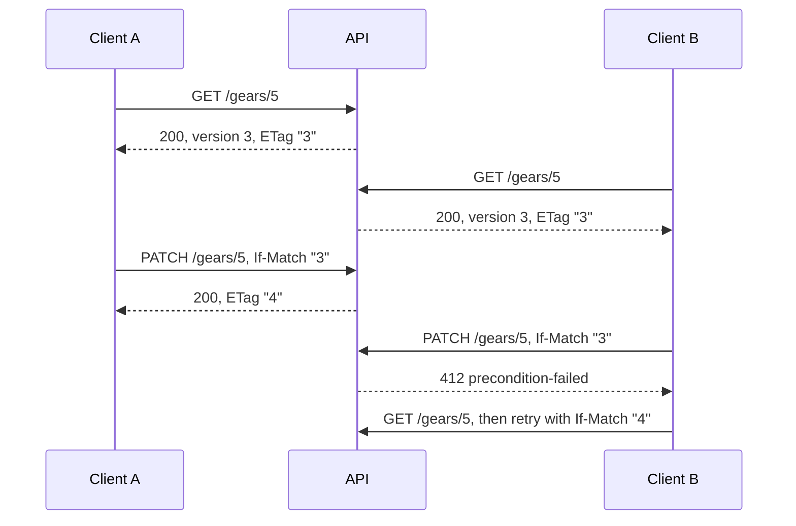

# Errors, concurrency and rate limits

Behaviour that applies to every endpoint of the API.

## Error responses

Every error the API returns is an [RFC 9457](https://www.rfc-editor.org/rfc/rfc9457) problem document with the media type `application/problem+json`. This holds whatever raised the error: a domain error, a request validation failure, an authentication failure or a rate-limit rejection. A client needs only one error path.

```json
{
  "type": "urn:endurain:error:not-found",
  "title": "Not Found",
  "status": 404,
  "detail": "Activity not found",
  "instance": "/api/v1/activities/42",
  "request_id": "5f0d3c1e8b7a4c9d"
}
```

| Member | Meaning |
| ------ | ------- |
| `type` | Stable URN for the kind of error. **Branch on this.** It is not a URL. A `type` keeps its URN and its meaning between releases, and a later release may give a case its own more specific `type` with the same status; see [Compatibility between releases](compatibility.md#refusals). `about:blank` means the status code says everything. |
| `title` | Short summary of the kind. The same for every occurrence of a `type`. |
| `status` | The HTTP status code, repeated in the body. |
| `detail` | Explanation of this occurrence. Safe to show to a user and never contains internal diagnostics. |
| `instance` | The request path. |
| `request_id` | The `X-Request-ID` of the request. Quote it in a bug report or to your server operator, who can find the exact log line with it. |
| `missing_scopes` | The scopes the credential lacks. Present only for a `403` caused by a missing scope. |
| `errors` | Field-level problems. Present only for a validation failure (`422`). |

Clients that only read `detail` keep working. Some errors carry extra members, such as `code` for a machine-readable subtype.

A `403` for a missing scope also sends `WWW-Authenticate: Bearer error="insufficient_scope", scope="a b"`, with the scopes the route requires separated by spaces ([RFC 6750](https://datatracker.ietf.org/doc/html/rfc6750#section-3.1)). An unknown path under `/api/v1` is `404` for every method; a known path with a method it does not offer is `405` with `Allow`. Every `GET` route also answers `HEAD` with the same headers and no body. `OPTIONS` is answered for CORS preflight only.

### Error types

<!-- generated:error-types -->

A request validation failure is `422` with `urn:endurain:error:validation-failed` and an `errors` list. Exceeding a rate limit is `429` with `urn:endurain:error:rate-limited`. A sensitive request from an account without a local password that carries no `idp_reauth` is `401` with `urn:endurain:error:idp-reauth-required` and a `WWW-Authenticate: Bearer error="insufficient_user_authentication", max_age="60"` header. A missing, expired or malformed access token, or one whose session has ended or whose user was deleted or deactivated, is `401` with `urn:endurain:error:invalid-token`: refresh the tokens and send the request again. Any other `401` is final, so do not refresh or retry it. A [step-up](account-security.md#step-up-refusal) whose password, MFA code or ticket does not verify is `403` with `urn:endurain:error:step-up-failed`, one answer for every failure. A password the [password rules](../features/accounts-and-sign-in.md#password-rules) refuse is `422` with `urn:endurain:error:password-too-short`, `password-too-common`, `password-breached` (found in a known data breach; only while the administrator turned the [breach check](../features/server-settings.md#password-policy) on), `password-matches-account` (the password equals, ignoring case, the username, the email, the email's local part or "endurain"), `password-blank` (only whitespace) or `password-unchanged` (the new password is the current one; password change and reset only), on every endpoint that sets a password. A Strava link whose granted scopes lack one the link needs (`read`, `profile:read_all`, `activity:read_all`) is `400` with `urn:endurain:error:provider-scope-insufficient`; send the `scope` Strava returned on the callback with `POST /strava/link`. An administrator's identity provider save refused because another provider already uses the issuer is `409` with `urn:endurain:error:issuer-in-use`, and one that changes the issuer of a provider with linked users is `409` with `urn:endurain:error:issuer-locked`. Unlinking the identity provider that is the account's only way to sign in (no local password and no other link), through `POST /profile/identity-providers/{idp_id}/unlink` or the administrator's `POST /users/{user_id}/identity-providers/{idp_id}/unlink`, is `409` with `urn:endurain:error:last-sign-in-method`: set a password or link another provider first. Confirming a sign-up with `POST /public/sign-up/confirm` while the server has email verification turned off is `403` with `urn:endurain:error:email-verification-disabled`; retrying does not help. An error raised without a specific type uses a slug of the HTTP status phrase. The user search (`GET /users?username_contains=`) is stricter than other lists: the term needs at least 3 characters, and `num_records` defaults to and may not exceed the server's page size (`num_records_per_page`, at most 100), so a shorter term or a larger page is `422`.

### A missing parent on a list

A resource that does not exist and one you may not see look the same, so an id cannot be probed. What you see depends on the route:

- **The parent itself is `404`:** `GET /activities/{activity_id}`, `GET /gears/{gear_id}`, and the single stream `GET /activities/{activity_id}/streams/{stream_type}`.
- **The lists under a parent are an empty page (`200`, `total` `0`), not `404`,** when the parent is missing or not visible to you: an activity's `laps`, `sets`, `workout-steps`, `streams` and `media`, and a gear's `components` (`GET /gears/{gear_id}/components`). An empty page therefore means "none", "does not exist" or "not yours".
- **Another user's lists are `404`** when that user does not exist, is inactive or awaits approval: `GET /users/{user_id}/activities` and `GET /users/{user_id}/activities/stats`.

Read the parent first when you need to tell the cases apart.

### Authentication errors

Authentication and authorization failures use the same shape. Typical causes:

| Status | Common causes |
| ------ | ------------- |
| `400` | Missing required fields, invalid client type, a wrong MFA or backup code (problem type `urn:endurain:error:invalid-mfa-code`, on a live sign-in challenge, the SSO token exchange and `POST /profile/mfa/enable`) |
| `401` | Invalid credentials, an unknown, expired, used or mismatched sign-in challenge, or one started before a security change on the account such as a password, MFA or email change or a sign-out everywhere (an `mfa_challenge` also ends after 3 wrong codes and is accepted only from the client network and client type of the password step; a `password_change_challenge` is accepted only for its client type), expired or invalid token |
| `403` | Insufficient permissions, missing required scope, a web write without `X-CSRF-Token` |
| `404` | Invalid session ID, user not found |
| `409` | A conflict with the current state: an MFA operation that does not fit the account's MFA state (already enabled, not enabled, no setup in progress), a user approval while the user's email is not verified, a username already taken |
| `429` | Too many login or OAuth attempts |

The `/auth/login` form takes a `username` and a `password` of at most 256 characters each; a longer one, like a NUL character, is `422` (`urn:endurain:error:validation-failed`).

## Concurrent edits with `ETag` and `If-Match`

Two clients that read the same record and then save it would silently overwrite each other: the second save wins and the first edit is gone, with no error. This happens in ordinary use, with the app open on a phone and a laptop. To prevent it, every record you can edit carries a **version**. You tell the API which version you read, and it refuses the edit if the record has moved on.



### Where to read the version

- **The `version` field** of every record in a response, including each item of a list. It is an integer that goes up by one whenever the record changes.
- **The `ETag` header** of a response that returns a single record, of every write that returns the updated record, and of every `201` that creates a record. It is the same number in quotes, such as `"7"`.

Every record you can edit or delete by id can also be read by id (`GET /health/weight/{id}`, `GET /gear-components/{id}`, `GET /profile/goals/{id}`, `GET /identity-providers/{id}` and so on). A `201` that creates one of them also sends a `Location` header with the path of that read. After a `412`, read the record again to get its current `ETag`. The exceptions are items you only revoke or remove, such as API keys, sessions, follow requests and identity links.

Use whichever is convenient. They always agree.

### Sending it back

Add the header to the write:

```http
PATCH /api/v1/gears/5
If-Match: "3"
```

`If-Match` is **required** on an edit of a versioned resource. The outcomes:

| Situation | Status | `type` |
| --------- | ------ | ------ |
| The header is missing | `428` | `urn:endurain:error:precondition-required` |
| The header names a version that is no longer current | `412` | `urn:endurain:error:precondition-failed` |
| The header is `*`, alone or in a list | `400` | `urn:endurain:error:invalid-input` |
| The header names the current version | `200` or `204` | The edit applies and the version goes up. |

Send the `ETag` you read, never `*`. The wildcard would match any version and so defeat the check, so the API refuses it on every route. A client that wants to overwrite what is there must read the record first and send the `ETag` it got.

On a `412`, read the record again, apply your change on top of what is there now and retry with the new version. Do not retry the same request: it will fail the same way.

A list of tags is accepted (`If-Match: "3", "4"`). A weak tag (`W/"3"`) never matches, as the HTTP standard requires for `If-Match`.

### Which requests need it

| Resource | Requests |
| -------- | -------- |
| Activities | `PATCH /activities/{id}` and `DELETE /activities/{id}` (the bulk edit of `PATCH /activities` has no single record and does not need it) |
| Gears and gear components | `PATCH` and `DELETE /gears/{id}`, `PATCH` and `DELETE /gear-components/{id}` |
| Health records | `PATCH` and `DELETE /health/{weight,water,steps,sleep,poop,fasting}/{id}`, and `POST /health/fasting/{id}/complete`, which changes the session it ends |
| Health targets | `PATCH /health/targets` |
| Your profile | `PATCH /profile`, using the profile's `ETag` or `version` |
| Your privacy settings | `PATCH /profile/privacy`, using the `ETag` of `GET /profile/privacy` (the privacy settings have their own version, also sent as `privacy_settings_version` by `GET /profile`) |
| Your default gear | `PATCH /profile/default-gear` |
| Your goals | `PUT` and `DELETE /profile/goals/{id}` |
| Users (administrators) | `PATCH /users/{id}` and `POST /users/{id}/delete`, which answers `202` because the account is erased by a [background job](background-operations.md#delete-a-user-administrators) |
| Your Strava client credentials | `PUT /strava/client` (answers `204` with the new `ETag`), using `integrations_version` from `GET /profile` (the credentials hold a secret, so they have no read of their own) |
| Identity providers (administrators) | `PATCH` and `DELETE /identity-providers/{idp_id}` |
| Server and mail settings (administrators) | `PUT /server-settings`, `PUT /server-settings/email/settings` |

Creating and the action endpoints (approve a user, change a password, link an account) do not take `If-Match`, except the administrator's user deletion above. Neither does deleting anything not listed above, such as an API key, a session, an activity photo or the login photo. Deleting your own account (`POST /profile/delete-account`) is confirmed with step-up instead; see [Background operations](background-operations.md#delete-your-account).

`PATCH /profile` and `PATCH /profile/privacy` answer `200` with the updated record and its new `ETag`, so the next edit needs no extra read.

!!! note
    A change made by the server itself also moves the version. For example, approving a user, a Garmin Connect sync that updates a day, or adding a water intake all change a record, so a form you opened before that gets a `412` on save. That is the intended behaviour: it tells you the record is not what you were looking at.

## Caching and correlation

- A JSON response that sets no `Cache-Control` of its own is `Cache-Control: private, no-cache`: a browser may keep it but must ask the server before it reuses it. A response that carries a token or a secret is `no-store`.
- The `ETag` of a record is its version, for `If-Match` on writes. It is not a cache validator: a `GET` never answers `304`, whatever `If-None-Match` says, because a response can carry data the version does not cover.
- Send `X-Request-ID` (letters, digits and hyphens, up to 64 characters) or a W3C `traceparent` header, and the server logs every line of the request under that id. Without `X-Request-ID` the trace id of a valid `traceparent` is the request id. The response repeats `X-Request-ID`, and `traceparent` and `tracestate` as sent. The server starts no spans of its own.

## Upload size limits

Every route that takes a file has its own limit on the request body: the largest file the route accepts plus 1 MiB for the multipart framing and form fields. The limit is published in the OpenAPI document as the `x-max-body-bytes` extension of the route's operation, so a client can read it instead of hard-coding a number. A body over the limit is refused with `413` and `urn:endurain:error:payload-too-large` before the route runs, whether the request declares a `Content-Length` or streams the body. Every other request body is limited to 10 MiB. A reverse proxy in front of Endurain must allow at least the largest of these limits. The limit of each upload and the formats it accepts are listed in [Background operations](background-operations.md#upload-limits-and-formats).

## Rate limits

Limits are counted per caller. A request with a valid, unexpired access token is counted per user (the token's `sub`), so users behind the same network address do not share a bucket and a token refresh does not reset it. Any other request, including one with a refresh token, a malformed or expired token or an API key, is counted per client network, and an IPv6 address by its `/64` network, so a client cannot get a fresh bucket by changing address within its block.

<!-- generated:rate-limits -->

When you exceed a limit the API answers `429` and sets these headers:

| Header | Meaning |
| ------ | ------- |
| `Retry-After` | Seconds until the window you are counted in ends. It counts down: a caller late in the window is told less than its length. |
| `X-RateLimit-Limit` | The limit you hit. |
| `X-RateLimit-Remaining` | Always `0` on a `429`. |

A lockout after failed sign-in, MFA or step-up attempts, and a `429` that relays a limit of Strava or Garmin Connect, also send `Retry-After` with the seconds until the lockout or the provider's limit ends. A `503` that asks you to try again later sends it too. Browsers can read `Retry-After`, `Content-Location`, `ETag` and `X-Request-ID` on cross-origin requests.

Each endpoint uses one tier. The rate limits listed per endpoint in the authentication pages are these tiers, and the full API documentation shows the rest.
