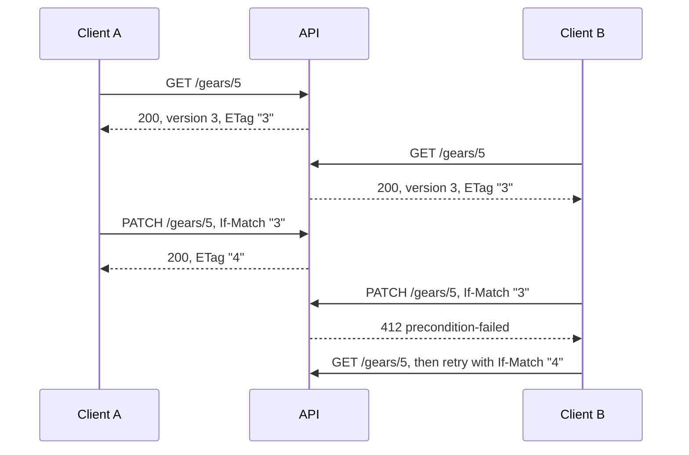

# Errors, concurrency and rate limits

Behaviour that applies to every endpoint of the API.

## Error responses

Every error the API returns is an [RFC 9457](https://www.rfc-editor.org/rfc/rfc9457) problem document with the media type `application/problem+json`. This holds whatever raised the error: a domain error, a request validation failure, an authentication failure or a rate-limit rejection. A client needs only one error path.

```json
{
  "type": "urn:endurain:error:not-found",
  "title": "Not Found",
  "status": 404,
  "detail": "Activity not found",
  "instance": "/api/v1/activities/42",
  "request_id": "5f0d3c1e8b7a4c9d"
}
```

| Member | Meaning |
| ------ | ------- |
| `type` | Stable URN for the kind of error. **Branch on this.** It is not a URL and it does not change between releases. `about:blank` means the status code says everything. |
| `title` | Short summary of the kind. The same for every occurrence of a `type`. |
| `status` | The HTTP status code, repeated in the body. |
| `detail` | Explanation of this occurrence. Safe to show to a user and never contains internal diagnostics. |
| `instance` | The request path. |
| `request_id` | The `X-Request-ID` of the request. Quote it in a bug report or to your server operator, who can find the exact log line with it. |
| `errors` | Field-level problems. Present only for a validation failure (`422`). |

Clients that only read `detail` keep working. Some errors carry extra members, such as `code` for a machine-readable subtype.

### Error types

<!-- generated:error-types -->

A request validation failure is `422` with `urn:endurain:error:validation-failed` and an `errors` list. Exceeding a rate limit is `429` with `urn:endurain:error:rate-limited`. An error raised without a specific type uses a slug of the HTTP status phrase.

### Authentication errors

Authentication and authorization failures use the same shape. Typical causes:

| Status | Common causes |
| ------ | ------------- |
| `400` | Missing required fields, invalid client type, no pending MFA login |
| `401` | Invalid credentials, expired token, invalid MFA code |
| `403` | Insufficient permissions, missing required scope |
| `404` | Invalid session ID, user not found |
| `429` | Too many login or OAuth attempts |

## Concurrent edits with `ETag` and `If-Match`

Two clients that read the same record and then save it would silently overwrite each other: the second save wins and the first edit is gone, with no error. This happens in ordinary use, with the app open on a phone and a laptop. To prevent it, every record you can edit carries a **version**. You tell the API which version you read, and it refuses the edit if the record has moved on.



### Where to read the version

- **The `version` field** of every record in a response, including each item of a list. It is an integer that goes up by one whenever the record changes.
- **The `ETag` header** of a response that returns a single record, and of every write that returns the updated record. It is the same number in quotes, such as `"7"`.

Use whichever is convenient. They always agree.

### Sending it back

Add the header to the write:

```http
PATCH /api/v1/gears/5
If-Match: "3"
```

`If-Match` is **required** on an edit of a versioned resource. The outcomes:

| Situation | Status | `type` |
| --------- | ------ | ------ |
| The header is missing | `428` | `urn:endurain:error:precondition-required` |
| The header names a version that is no longer current | `412` | `urn:endurain:error:precondition-failed` |
| The header names the current version | `200` or `204` | The edit applies and the version goes up. |
| `If-Match: *` | `200` or `204` | The edit applies whatever the version is. |

On a `412`, read the record again, apply your change on top of what is there now and retry with the new version. Do not retry the same request: it will fail the same way. Use `If-Match: *` only when you really mean "overwrite whatever is there".

A list of tags is accepted (`If-Match: "3", "4"`). A weak tag (`W/"3"`) never matches, as the HTTP standard requires for `If-Match`.

### Which requests need it

| Resource | Requests |
| -------- | -------- |
| Activities | `PATCH /activities/{id}` and `DELETE /activities/{id}` (the bulk edit of `PATCH /activities` has no single record and does not need it) |
| Gears and gear components | `PATCH` and `DELETE /gears/{id}`, `PATCH` and `DELETE /gear-components/{id}` |
| Health records | `PATCH` and `DELETE /health/{weight,water,steps,sleep,poop,fasting}/{id}`, and `POST /health/fasting/{id}/complete`, which changes the session it ends |
| Health targets | `PATCH /health/targets` |
| Your profile | `PATCH /profile`, using the profile's `ETag` or `version` |
| Your privacy settings | `PATCH /profile/privacy`, using `privacy_settings_version` from `GET /profile` (the privacy settings have their own version) |
| Your default gear | `PATCH /profile/default-gear` |
| Your goals | `PUT` and `DELETE /profile/goals/{id}` |
| Users (administrators) | `PUT /users/{id}` and `DELETE /users/{id}`, which still answers `202` because the account is erased by a background job |
| Your Strava client credentials | `PUT /strava/client`, using `integrations_version` from `GET /profile` |
| Identity providers (administrators) | `PUT` and `DELETE /identity-providers/{idp_id}` |
| Server and mail settings (administrators) | `PUT /server-settings`, `PUT /server-settings/email/settings` |

Creating and the action endpoints (approve a user, change a password, link an account) do not take `If-Match`. Neither does deleting anything not listed above, such as an API key, a session, an activity photo or the login photo. Deleting your own account (`POST /profile/delete-account`) is confirmed with step-up instead.

`PATCH /profile` and `PATCH /profile/privacy` answer `200` with the updated record and its new `ETag`, so the next edit needs no extra read.

!!! note
    A change made by the server itself also moves the version. For example, approving a user, a Garmin Connect sync that updates a day, or adding a water intake all change a record, so a form you opened before that gets a `412` on save. That is the intended behaviour: it tells you the record is not what you were looking at.

## Rate limits

Limits are counted per caller: an authenticated request is counted per access token, so users behind the same network address do not share a bucket, and an unauthenticated request is counted per client address.

<!-- generated:rate-limits -->

When you exceed a limit the API answers `429` and sets these headers:

| Header | Meaning |
| ------ | ------- |
| `Retry-After` | Seconds until you can retry. |
| `X-RateLimit-Limit` | The limit you hit. |
| `X-RateLimit-Remaining` | Always `0` on a `429`. |

Each endpoint uses one tier. The rate limits listed per endpoint in the authentication pages are these tiers, and the full API documentation shows the rest.
