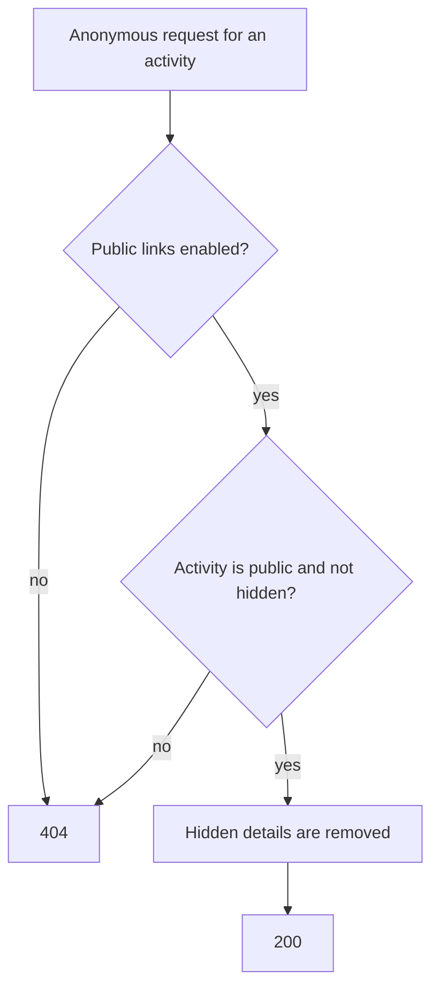

# Public endpoints

Most of the API needs a signed-in user. A few endpoints answer without any credentials, for a visitor who is not signed in. This page lists them, what they return and what they refuse. All paths are under `/api/v1`.

Public endpoints send no `Authorization`, `X-Client-Type` or `X-CSRF-Token` header. They are rate limited per client address with the default limit (see [Errors, concurrency and rate limits](errors-and-limits.md#rate-limits)), so set `TRUSTED_PROXIES` correctly behind a proxy.

## Shared activities

These serve an activity that its owner made public. They work only when an administrator has enabled [public shareable links](../features/sharing-and-privacy.md#public-links).

| Method and path | Returns |
| --------------- | ------- |
| `GET /public/activities/{activity_id}` | The activity |
| `GET /public/activities/{activity_id}/laps` | A page of laps |
| `GET /public/activities/{activity_id}/sets` | A page of workout sets |
| `GET /public/activities/{activity_id}/workout-steps` | A page of workout steps |
| `GET /public/activities/{activity_id}/streams` | A page of streams |
| `GET /public/activities/{activity_id}/streams/{stream_type}` | One stream |
| `GET /public/activities/exercise-titles` | The exercise title reference table |
| `GET /public/users/id/{user_id}` | The owner's public profile: id, name, username, city and photo URL |

What to expect:

- **404 for everything that is not shareable.** An activity that does not exist, is not public, is hidden, or whose links are switched off all answer `404` with the same body, so an id cannot be probed to see which activities exist.
- **Hidden details are removed.** What the owner chose to [hide from others](../features/activities.md#visibility-and-hiding-details) (location, map, heart rate and so on) is missing from the response, and the laps, sets, streams and steps of an activity that hides them are not served.
- **The user endpoint needs two settings.** It answers only when public links and **Show user info on public links** are both on; otherwise `404`. It never includes an email, birthdate or access level.
- **Lists are paged** with `page_number` and `num_records` (the same envelope as the authenticated lists).

## Signed media links

Thumbnails, activity photos and profile photos are served by URLs that carry a signed token in the query string. They need no login so that they work in an ``, and the signature is the access control.

| Path | Carries |
| ---- | ------- |
| `GET /activities/{activity_id}/thumbnail?t=<token>` | The activity's map preview (WebP) |
| `GET /activities/{activity_id}/media/{media_id}/file?t=<token>` | One activity photo |
| The `photo_path` URL in a user | A profile photo |

You do not build these URLs. The API puts a ready-to-use URL in the field of the response (`map_thumbnail_url`, a media item's URL, a user's `photo_path`), and it only does so for something the caller may see. Treat them as opaque:

- A wrong, forged or expired token answers `404`, never `403`, so the response does not confirm that the file exists.
- A link is valid for 24 hours. Reading the activity again returns a fresh link, so a client should use the URL from the response it just received, not store it.
- The token is derived from the server's `SECRET_KEY`, so changing the key makes every previously issued link stop working until it is fetched again.
- Responses are cacheable by the browser for an hour (`Cache-Control: private`).
- Anyone who holds a link can open that one file until it expires. Do not post links from a private activity.

## Server information

| Method and path | Returns |
| --------------- | ------- |
| `GET /about` | API name, version and licence. Does not touch the database |
| `GET /health` | `{"status": "ok"}` if the database answers, otherwise `503`. See [Monitoring](../getting-started/monitoring.md) |
| `GET /public/server-settings` | The public subset of the server settings: units, currency, records per page, whether sign-up, SSO and local login are on, the SSO auto-redirect flag, the public sharing flags, the tile server URL, attribution and background colour, the password policy (type and minimum lengths, so the sign-up form can validate), whether a login photo is set and the allowed SSO redirect schemes. The sign-up approval and verification switches, geocoding, session and retention settings, API keys and every other secret are not included |
| `GET /public/server-settings/tile-maps-templates` | The map tile presets an administrator can pick |
| `GET /public/idp/{slug}/icon` | The image uploaded for an identity provider, or `404` if it has none. Supports `ETag` and `If-None-Match` |
| `GET /public/server-settings/login-photo` | The login page photo, or `404` if none is set. Supports `ETag` and `If-None-Match`, so a client that has the photo gets `304` |

The server settings are public by design: the login page needs them before anyone signs in. That includes the tile URL, so do not put a secret in it. See [Map tile server](../getting-started/advanced-setup.md#map-tile-server).

## Sign-in and account flows

These need no credentials because their job is to obtain them. They are documented with the flows they belong to:

| Path | Purpose | See |
| ---- | ------- | --- |
| `POST /auth/login`, `/auth/mfa/verify`, `/auth/refresh`, `/auth/logout` | Password login, MFA and tokens | [Handling authentication](authentication.md) |
| `GET /public/idp`, `/public/idp/login/{slug}`, `/public/idp/callback/{slug}`, `POST /public/idp/session/{id}/tokens` | Single sign-on | [OAuth/SSO and PKCE](oauth-sso-pkce.md) |
| `POST /sign-up/request`, `/sign-up/confirm` | Create an account and verify its email | [Accounts, sign-up and password reset](../features/accounts-and-sign-in.md#signing-up) |
| `POST /password-reset/request`, `/password-reset/confirm` | Reset a forgotten password | [Accounts, sign-up and password reset](../features/accounts-and-sign-in.md#forgotten-password) |
| `GET /public/onboarding`, `POST /public/onboarding` | Create the first administrator of a new installation | [First-run onboarding](#first-run-onboarding) |

The sensitive ones (login, MFA, sign-up, reset, onboarding) have a tighter 10 requests per minute limit.

### First-run onboarding

A new installation has no account. These two endpoints create the first administrator, and only while the installation has no account at all. See [First sign-in](../getting-started/quick-start.md#first-sign-in).

| Method and path | Returns |
| --------------- | ------- |
| `GET /public/onboarding` | `{"onboarding_required": true}` while no account exists, otherwise `false`. Once an account exists it never becomes `true` again |
| `POST /public/onboarding` | Body `{"token", "name", "username", "email", "password"}`. Creates an active administrator with a verified email and answers `201` with the user |

What to expect from `POST /public/onboarding`:

- **The token comes from the server log.** While no account exists, every API worker logs a one-time setup token at startup (field `setup_token`). It is valid for 24 hours and works once; a restart prints a new one.
- **`409` once any account exists.** The endpoint never creates a second account, whatever the token.
- **`400`** for a token that is unknown, expired or already used.
- **`422`** for a password that does not meet the administrator password policy, or for an unknown field. The role and account state are not accepted from the client.
- **Two requests at the same time** still create one administrator: the other answers `409`.

## Not public

For clarity, these are never served without credentials: user lists and profiles beyond the one public projection above, activities that are not public, follower lists, health data, notifications and settings. The WebSocket also needs a ticket; see [Realtime updates](realtime.md).
