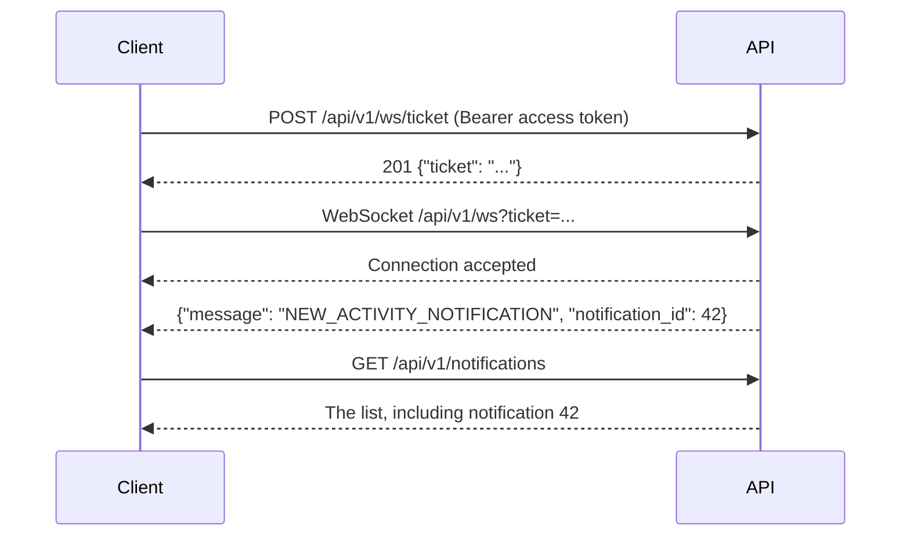
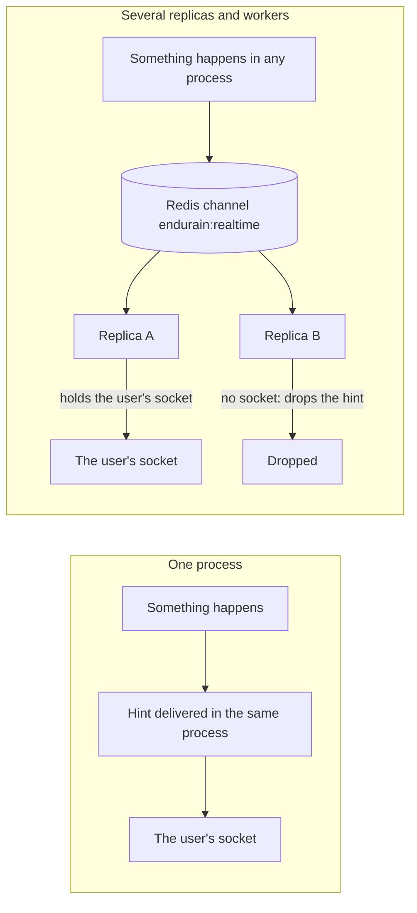

# Realtime updates

Endurain pushes small "something changed, fetch it again" hints to signed-in clients over a WebSocket, so the notification bell updates without polling. The hint is not the data: the client fetches the data through the normal API. This page is the contract for building a client.

Use it as an optimisation. Everything it announces is also available by polling the API, and a client that never connects loses nothing except freshness.

## Connecting

Opening a socket takes two steps, so that the access token never appears in a URL.



1. **Get a ticket.** `POST /api/v1/ws/ticket` with the usual authenticated headers (`Authorization`, `X-Client-Type`, and `X-CSRF-Token` for web). It needs the `notifications:read` scope and is rate limited like other writes. The response is `{"ticket": "<opaque string>"}`.
2. **Open the socket** with the ticket in the query string: `ws(s)://<host>/api/v1/ws?ticket=<ticket>`. Use `wss` when the site is served over HTTPS.

A ticket is single use, bound to your user and valid for 30 seconds. Fetch a new one for every connection attempt, including every reconnect.

### Origin check

A browser sends an `Origin` header with the handshake. Endurain accepts it only when the origin is one it serves (the same list as CORS: your `ENDURAIN_HOST`, and the development origins in `development`). A different origin is refused with close code `1008`. A client that sends no `Origin`, such as a mobile app, is accepted, and the ticket still authenticates it.

## Messages

The server sends JSON text frames. The client sends nothing: a text or binary frame from the client is a protocol violation and closes the connection with `1008`.

```json
{ "message": "NEW_ACTIVITY_NOTIFICATION", "notification_id": 42 }
```

`message` says what changed. A notification message also carries `notification_id`, the stored notification, and means "fetch your notifications again". `GEARS_CHANGED` and `HEALTH_CHANGED` carry nothing else and mean "fetch that data again". `JOB_STATUS_CHANGED` means "read that job's status again" through its status route. A client that keeps polling a job can poll slowly while it is connected, and read the status at once when its `job` arrives; a hint can be lost, so keep a slow poll as the fallback.

| `message` | When |
| --------- | ---- |
| `NEW_ACTIVITY_NOTIFICATION` | An activity of yours was stored |
| `NEW_DUPLICATE_ACTIVITY_START_TIME_NOTIFICATION` | A stored activity has the same start time as another |
| `NEW_FOLLOWER_REQUEST_NOTIFICATION` | Someone asked to follow you |
| `NEW_FOLLOWER_REQUEST_REMOVED_NOTIFICATION` | A follow request to you was withdrawn |
| `NEW_FOLLOWER_REQUEST_ACCEPTED_NOTIFICATION` | Someone accepted your follow request |
| `GARMIN_TOKEN_EXPIRED_NOTIFICATION` | Garmin Connect was unlinked because its login expired |
| `ADMIN_NEW_SIGN_UP_APPROVAL_REQUEST_NOTIFICATION` | A sign-up waits for an administrator |
| `GEARS_CHANGED` | A Garmin Connect or Strava gear sync finished and stored your gear |
| `HEALTH_CHANGED` | A Garmin Connect health sync finished and stored your health data |
| `JOB_STATUS_CHANGED` | A background job you started finished, failed or needs input. The frame also carries `job`: `garmin-link`, `strava:link`, `strava:unlink` or `ingestion:<job id>` |

Ignore a `message` you do not recognise: new types can be added. The notification meanings are in [Notifications](../features/notifications.md).

## Closing and reconnecting

| Close code | Meaning | What the client should do |
| ---------- | ------- | ------------------------- |
| `1008` | Invalid or expired ticket, origin not allowed, or the client sent data | Get a fresh ticket and reconnect. If it keeps failing, check the access token and the origin |
| `1013` | The ticket store is unavailable | Retry later with backoff |
| `1001` | The server ended a connection after 15 minutes | Reconnect with a new ticket |
| `4001` | This connection was replaced by a newer one | **Do not reconnect** automatically |

Why a connection ends after 15 minutes: the ticket is checked only when the connection opens, so a fixed lifetime forces a periodic reconnect, which needs a valid access token. A session that was revoked loses its socket at the next reconnect.

Each user can hold 5 sockets per server process (several tabs or devices). A sixth connection closes the oldest with `4001`. Reconnecting on `4001` would make tabs past the limit evict each other in a loop, so a client should wait until the user shows they want live updates, for example when the tab becomes visible again.

On any other close, reconnect with exponential backoff and jitter. The web app starts at 1 second, doubles up to 30 seconds and adds up to 30 % random jitter. On the initial connection and after a reconnect, fetch your notifications once, because hints sent before the socket was ready or while it was down are not replayed.

## What the server guarantees

- **At most once, best effort.** A hint can be lost: while a replica reconnects to Redis, when a socket is closing, or when the user has no socket on that server at the time. The notification itself is saved first and is never lost this way.
- **No ordering, no replay.** Treat each hint as "refetch", not as an event to count.
- **Keep a slow fallback.** In visible tabs, the unread badge polls every minute while disconnected and every five minutes while connected. Notification hints and each initial/reconnected socket trigger an authoritative refetch; the preview list refetches when its menu opens. The connected fallback covers hints lost during a server-side realtime-channel gap even while the browser socket is open.

## Local and distributed deployments



- **Local:** no Redis is involved. The hint goes straight to the sockets of the same process.
- **Distributed or several workers:** the process that notices the change, whether an API replica or a job worker, publishes the hint on the Redis channel `endurain:realtime`. Every API replica receives it, and the one that holds the user's socket forwards it. The others drop it.
- The channel carries the same Redis connection as the event bus, so it needs `EVENTS_URI` or `REDIS_URL`. Two deployments must not share a Redis server, or they would see each other's hints.
- The limit of 5 sockets per user is per process, so behind a load balancer with several replicas a user can hold up to 5 on each.

See [Scaling and background jobs](../getting-started/scaling-and-background-jobs.md#live-updates) for the operator's view.
